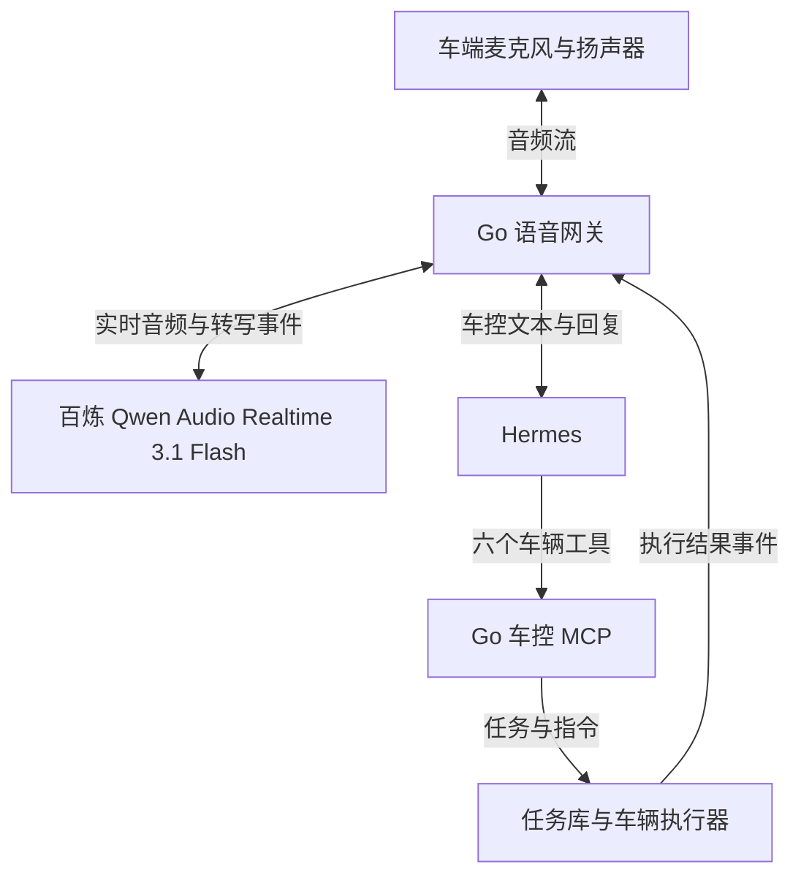

# Hermes 语音车控任务设计

车端收发音频，阿里云百炼 Qwen-Audio-3.1-Realtime-Flash 负责前端 S2S 语音交互。Go 语音网关通过 WebSocket 接入百炼、管理语音轮次和播报，并把车辆相关的最终转写交给 Hermes。Hermes 理解车控意图、发起追问和调用 MCP。Go 车控服务持久化任务、提供待回复上下文、校验参数、下发命令并确认执行结果。

## 0. 车端 S2S 语音入口



### 通话从音频开始

| 步骤 | 调用链路 | 请求 | 响应与处理 |
| --- | --- | --- | --- |
| 0.1 建立语音会话 | 车端 ↔ Go 语音网关 | 认证、业务 `session_id`、音频格式、播放能力。建议用双向 WebSocket 接音频和控制帧 | Go 绑定用户及车辆，建立语音连接。多车目标未确定时先澄清。 |
| 0.2 接入前置模型 | Go ↔ 百炼 Qwen Realtime | 建立 WebSocket，配置会话，流式发送音频，由车端或 Go 判定说话结束并提交 | 百炼确认配置和音频提交，返回带输入项 ID 的最终转写。Go 根据分流结果决定是否请求模型生成语音。 |
| 0.3 固定本轮输入并分流 | Go 内部 | 绑定到同一个音频输入项的 `transcript.final`、车辆能力和当前待回复候选 | Go 固化 `voice_turn_id`、`request_id` 和最终原话。普通对话走 S2S 原生语音。车辆控制、车况、车书、待办、可能的追问回复和无法可靠分流的表达交 Hermes。 |
| 0.4 处理车辆语音 | Go → Hermes → Go MCP | 最终原话放进 Runs `input`，候选和 Schema 放进 `instructions` | Hermes 调用车辆 MCP 并输出文本。S2S 会话无车辆 MCP 写权限。Go 读取自身业务状态，选定本轮可播报文本。 |
| 0.5 播报及执行反馈 | Go → 车端 | 普通对话的 S2S 音频，或车控回复、独立执行结果的语音 | 网关按本轮 `playback_id` 交付音频。首期车控回复由现有 TTS 播报 Go 批准的文本。H09 验证百炼能可靠渲染指定文本后，再考虑接入车控播报。 |

Go 用同一轮的最终输入转写做分流和车控校验。部分转写可用于交互预览。最终转写缺失、空白或无法可靠校验时请用户重说，车辆写入等待有效输入。分流由 Go 根据当前原话、会话和候选完成，具体操作与参数匹配留给 Hermes。例如正在等待车窗位置时，「左后窗」进入 Hermes，即使这一句没有动词。闲聊走 S2S 的直接语音生成，避免增加一次 Hermes Run。

### 轮次、播报和打断

- **独立标识。** 车端业务 `session_id` 可跨 S2S 重连，`s2s_session_id` 和连接代数只标识供应商会话。Go 将供应商音频 `input_item_id` 映射到全局 `voice_turn_id`，并在转交 Hermes 时关联唯一 `request_id`。重复最终转写复用本轮结果。新连接隔离旧连接迟到的转写和音频帧。
- **播报权。** Go 在分流完成后才允许生成或播放对应音频。原生 S2S 聊天走百炼音频链路。车控只播 Go 批准的 Hermes 追问、处理中提示或车辆结果。受理和已执行使用各自的文本。Hermes 最终文本提供候选回复，实际业务状态来自 Go。
- **用户插话。** 用户开始讲话时，车端停止当前播放，Go 取消在途音频生成并丢弃旧播放代数的帧。Go 用轮次状态协调取消和车控提交。取消先于写入时拒绝迟到工具调用，已提交的任务或命令继续执行并保留结果。收到新一轮语音后按当前候选重新分流。
- **回执与重连。** `speech.reply` 表示当前轮的语义回复，`playback_id` 标识一次语音交付，`event_id` 标识独立车辆结果。操作已确认后用同一 `event_id` 去重。车辆结果在不打断用户说话的时机播报，断线期间保留业务结果。重连复用业务会话和已获得的状态，未提交或不完整的音频轮次请用户重说。

### 阿里云百炼 WebSocket 接口

首期模型为 `qwen-audio-3.1-realtime-flash`。北京环境示例为 `wss://{WorkspaceId}.cn-beijing.maas.aliyuncs.com/api-ws/v1/realtime?model=qwen-audio-3.1-realtime-flash`。采用百炼推荐的业务空间专属域名，按地域配置 Workspace ID 和 API Key。Go 在握手时设置 `Authorization: Bearer <API_KEY>`，密钥由 Go 服务端持有。[百炼 Qwen-Audio-Realtime WebSocket 接入](https://help.aliyun.com/zh/model-studio/audio-realtime-websocket-access) · [3.1 Flash 模型说明](https://help.aliyun.com/zh/model-studio/qwen-audio-3-1-realtime-flash)

Go 收到 `session.created` 后发送如下会话配置，等待 `session.updated` 确认后才向车端发出 `session.ready`。首期使用百炼的 push-to-talk 协议模式，车端或 Go 仍可用本地 VAD 自动提交，也可用按键结束事件提交。设计要求先取得最终转写再分流，仅在普通对话时触发 Qwen 出声。H09 首先用真实连接验证百炼能在 `response.create` 之前返回已提交音频的最终转写。

```json
{
  "type": "session.update",
  "session": {
    "modalities": ["text", "audio"],
    "voice": "longanqian_v3.1",
    "input_audio_format": "pcm",
    "output_audio_format": "pcm",
    "input_audio_transcription": {"language": "zh"},
    "turn_detection": null
  }
}
```

| 阶段 | Go → 百炼 | 百炼 → Go 与业务动作 |
| --- | --- | --- |
| 输入与提交 | 将单声道 16 kHz、16-bit 小端的裸 PCM 分片以 Base64 放入 `input_audio_buffer.append` 事件的 `audio` 字段。本轮结束只发送一次 `input_audio_buffer.commit`。 | `input_audio_buffer.committed` 返回 `item_id`。Go 将该音频项与当前连接代数和 `voice_turn_id` 关联。 |
| 转写与分流 | 等待同一 `item_id` 的最终转写。 | `conversation.item.input_audio_transcription.completed` 的 `transcript` 映射到内部 `FinalTranscript`。`delta` 仅用于预览。空转写、`conversation.item.input_audio_transcription.failed` 或超时走重说流程。 |
| 普通对话 | 分流结果为普通对话时发送 `response.create`。车辆相关轮次交 Hermes。 | 按 `response.created` 分配的 `response.id` 关联同轮 `response.audio.delta`，解码 PCM 音频并流式播放，处理 `response.done` 的终态。输出按 24 kHz PCM 接入，H09 实测确认。 |
| 打断 | 用户起讲时先停止车端播放。如果百炼仍在生成，发送 `response.cancel`。 | 用 `response.done` 的 `cancelled` 终态收敛当前响应。Go 丢弃旧播放代数和旧响应 ID 的后续音频。取消未收敛时按连接恢复流程处理，再触发下一轮生成。 |

握手、`session.created`、`session.updated` 和首段音频分别记录耗时。若等待配置确认期间遇到 `error` 或 WebSocket 关闭，保留阶段、事件 ID 和关闭码供诊断。Go 用百炼会话的最终输入转写作为 Hermes 的文本输入。音频交互走双向会话，下文用 `POST /voice/utterances` 模拟转写进入后端编排的边界。[Qwen-Audio-Realtime 客户端事件](https://help.aliyun.com/zh/model-studio/fun-audiochat-client-events) · [Qwen-Audio-Realtime 服务端事件](https://help.aliyun.com/zh/model-studio/qwen-audio-realtime-server-events)

## 1. 车控下发流程

### 参数齐全时直接下发

用户说「把左后窗关上」。Hermes 根据 `window.close` 的 Schema 填入 `position=rear_left`，直接调用一次 `dispatch_vehicle_command`。Go 校验车辆权限、能力与参数，在同一个数据库事务里创建「待下发」任务、保存最终参数并登记待发指令。提交后返回业务任务 ID、指令 ID 和状态，Go 异步下发并确认结果。

### 缺少必填参数时先建任务并追问

1. 用户说「把车窗关一下」。车端发送音频，Go 语音网关从 S2S 取得本轮最终转写并调用 `POST /v1/runs`。Hermes 确定动作是 `window.close`，缺少 `position`，于是调用 `create_vehicle_task`。
2. Go 保存「待回答」任务 `T101`，记录所属会话、目标车辆、已有参数、缺失字段和当前问题。从创建时刻起计时 10 分钟，保存 `expires_at` 并返回任务信息。Hermes 用普通助手文本问「关哪扇窗？」这轮正常结束，Runs SSE 的 `run.completed` 提供最终回复。
3. 用户说「左后窗」。Go 沿用业务会话，从 S2S 取得新一轮最终转写。Go 查询同一会话下当前车辆未过期的「待回答」任务，按创建时间从新到旧取最多 3 条。在调用新的 `POST /v1/runs` 时，将本轮最终转写放入 `input`，并将候选任务列表 `pending_tasks` 放入本轮 `instructions`。下面示例中有两条候选。

```json
{
  "pending_tasks": [
    {
      "task_id": "T102",
      "device": "hvac",
      "tool": "set_climate",
      "known_params": {"power": "on"},
      "missing_fields": ["temperature_c"],
      "question": "空调调到几度？"
    },
    {
      "task_id": "T101",
      "device": "window",
      "tool": "close",
      "known_params": {},
      "missing_fields": ["position"],
      "question": "关哪扇窗？"
    }
  ]
}
```

4. Hermes 结合用户原话、各任务的问题和缺失字段进行匹配。「左后窗」能补齐 `T101` 的 `position`，因此调用 `dispatch_vehicle_command` 并传入 `task_id: T101`。如果有多条任务都合理匹配，先用普通回复确认用户指的是哪条。

```json
{
  "task_id": "T101",
  "device": "window",
  "tool": "close",
  "params": {"position": "rear_left"}
}
```

5. Go 校验 `task_id` 属于本轮提供的候选，且任务属于当前会话和车辆，并确认设备、动作和参数符合原任务。事务内再次检查任务仍处于「待回答」且未过期。Go 在同一个事务中保存最终参数、登记指令并将 `T101` 推进到「待下发」，之后异步下发和确认结果。发起追问和处理答复通过不同的 Hermes Run 关联到同一个业务任务。

## 2. MCP 和工具清单

车控任务 MCP 服务暴露以下六个入口。`device → tool` 是功能地图中的业务操作，例如 `window.close`。同类操作共用一个 MCP 入口。缺少参数时，Hermes 通过普通助手回复向用户追问。

| 类型 | 工具 | 什么时候用 | 输入与返回 |
| --- | --- | --- | --- |
| 自建 MCP | `create_vehicle_task` | 车控意图已明确，仍缺少必填参数等需要用户补充的信息 | 输入 `device`、`tool` 和已知参数。创建「待回答」任务并设置 10 分钟有效期，返回业务任务 ID、状态、缺失字段、当前问题和 `expires_at` |
| 自建 MCP | `list_vehicle_tasks` | 用户问「还有什么没做完」，或明确要找回之前的任务 | 默认查当前会话的未完成任务。返回动作、状态和缺失参数。用户身份与查询范围由 Go 校验 |
| 自建 MCP | `dispatch_vehicle_command`（下发车控指令） | 所需参数已齐备，可以请求执行 | 输入 `device`、`tool`、`params` 和可选的 `task_id`。续办原任务时带 `task_id`，新指令省略该字段。Go 按操作的 Schema 校验，并在登记指令的事务中更新原任务或创建新任务。返回业务任务 ID、指令 ID 和当前状态 |
| 自建 MCP | `get_vehicle_status`（查询车况） | 用户询问车辆当前状态 | 输入 `device`、`tool` 和 `params`，支持在一次调用中查询同类设备的多个位置。返回状态、采样时间和可用性 |
| 自建 MCP | `search_vehicle_manual`（查询车书） | 用户问功能怎么用、设置入口在哪 | 输入用户原话和可选的 `topic_id`。按车型和车书版本检索，返回段落及出处 |
| 自建 MCP | `search_vehicle_capabilities`（搜索功能地图） | 首轮候选不足时，补查车控、车况或车书主题 | 输入搜索词。返回当前车辆适用的工具候选、参数 Schema 或车书主题 |

## 3. ID 与状态归属

| 标识 | 由谁管理 | 用途 |
| --- | --- | --- |
| 业务任务 ID，如 `T101` | Go | 对应 MySQL 中的一条任务，跨轮关联追问、下发和车辆确认 |
| Run ID | Hermes | 标识一次 Runs API 执行。发起追问和处理答复分别使用各自的 Run ID |
| 车控指令 ID | 车控执行层 | 将车辆回执关联到对应的执行和任务 |

补齐参数与请求下发共用一次 MCP 调用。后续状态由 Go 根据下发结果和车辆回执更新。

参数齐全的新任务从「待下发」开始。需要补充信息的任务从「待回答」进入「待下发」。两种路径都由 Go 推进到「执行中」，并在确认成功后标记「已完成」。Go 用当前会话上下文校验工具传入的 `task_id`。续办时以仍为「待回答」且 `expires_at` 晚于 Go 当前时间为条件原子推进状态，避免重复答复触发重复下发。`task_id` 校验失败时返回错误。命令重试时沿用同一幂等键，前提是下游支持。

### 等待回复超时

- Go 创建「待回答」任务时，设置 `expires_at = created_at + 10 分钟`。插话、查询和重新播报追问均沿用这个截止时间。
- Go 定时将已到期且仍为「待回答」的任务标记为「已超时」。候选查询和续办下发都即时检查 `expires_at`。即使定时扫描尚未将状态落库，到期任务也已失效。
- 超时处理和下发共用「待回答」状态作为更新条件。已经进入「待下发」的任务按异步确认流程处理。待回复超时的任务不再续办，用户可以重新发起车控指令。

## 4. 多任务匹配与插话恢复

- **匹配待回答任务。** Go 为新 Run 注入最近 3 条有效候选，Hermes 根据问题、缺失字段和原话选择可唯一匹配的 `task_id`。创建时间只用于筛选候选。多条都可能匹配时，先确认是哪条，再下发。
- **插话查询。** 用户说「左后窗开着吗？」时，Hermes 走车况查询，`T101` 继续等待。用户随后明确回答「关左后窗」时，可在 `T101` 仍有效且属于本轮候选的情况下续办。
- **新的完整车控指令。** 用户说「把空调调到 25 度」时，Hermes 调用下发工具并省略 `task_id`，Go 为本次空调操作创建新任务。
- **主动查询待办。** Hermes 按需调用查询工具。已完成任务按用户明确需求查询。

## 5. 异步下发与完成确认

1. **请求阶段。** Go 创建或更新任务并持久化待发指令后，返回「待下发」、业务任务 ID 和指令 ID。Hermes 可以回复「已收到请求，正在处理」并结束当前轮次。Go 执行器随后异步下发。
2. **确认阶段。** Go 用指令 ID 关联车辆回执，或根据下发后的新车况验证目标状态。空调场景要确认已开启且设定为 25 度。成功后由 Go 更新原业务任务为「已完成」，并产生完成事件。仅收到受理回执时继续等结果。超时且无法确认时标记「结果待确认」。
3. **反馈阶段。** Go 语音网关收到车辆结果事件后，按 §0 的播报策略交付结果。只有需要 Agent 判断下一步时，才由完成事件启动新的 Hermes 轮次，传入原业务任务 ID、指令 ID 和确认结果。重复回执只允许推进一次完成状态，重复完成事件按指令 ID 去重。

## 6. 车况查询工具

`get_vehicle_status` 是同一个 MCP 服务里的只读工具。Hermes 调用 Go 查询车况后，在当前轮次作答。查询无需创建车控任务。

- **输入。** 使用 `device`、`tool` 和 `params`。例如 `window.get_status` 的 `params.positions` 接受车窗位置数组，支持一次查询四个车窗。Go 从可信会话上下文解析车辆，校验权限和参数，并将位置映射为该车型的车况信号。如果有多辆车且目标不明确，先追问车辆。
- **返回。** 每个信号独立返回状态、采样时间和数据可用性。例如左后窗状态可以是 `closed`、`open`、`partially_open` 或 `unknown`，数据可用性可以是 `fresh`、`stale` 或 `unavailable`。Go 根据采样时间判定新鲜度。
- **示例。** 用户问「左后窗关了吗？」Hermes 调用 `get_vehicle_status`，传入 `{"device":"window","tool":"get_status","params":{"positions":["rear_left"]}}`。Go 返回状态 `closed` 且数据为 `fresh`，Hermes 回答「左后窗已关」。如果数据过旧，说明「上次上报时已关，目前无法确认」。四窗查询只有在四条数据均有效且均为关闭时，才回答「车窗都关了」。

车控执行器也可以复用 Go 的车况读取逻辑做执行验证。验证时检查目标车辆、目标信号，以及样本是否在指令下发后采集。

## 7. 功能地图、Schema 与工具召回

功能地图按 `device → tool` 组织。每个 `tool` 对应一个具体业务操作，`params` 由该操作的 JSON Schema 定义。车控和车况使用同一套设备命名，分别通过下发和查询入口调用。

| Device | Tool | 参数 Schema 约束 | MCP 入口 |
| --- | --- | --- | --- |
| `hvac` | `set_temperature` | `temperature_c` 必填，温度范围按车型配置 | `dispatch_vehicle_command` |
| `hvac` | `set_power` | 只提交 `power=on/off`，保留车辆原设温 | `dispatch_vehicle_command` |
| `hvac` | `set_climate` | `power` 和 `temperature_c` 必填，可一次提交开启与设温 | `dispatch_vehicle_command` |
| `window` | `close` | `position` 必填，枚举为左前、右前、左后、右后 | `dispatch_vehicle_command` |
| `window` | `get_status` | `positions` 必填，可一次传入多个车窗位置 | `get_vehicle_status` |

「把左后窗关上」的调用示例：

```json
{
  "device": "window",
  "tool": "close",
  "params": { "position": "rear_left" }
}
```

1. **首轮预筛。** Go 收到语音轮次的最终转写后，先按当前车型和配置限定可用能力，再用 BM25 从工具名称、说明、别名和常见话术中召回少量候选。Hermes 收到上层导航、固定 MCP 工具、命中项的 `device`、`tool`、调用入口和参数 Schema，以及最近 3 条有效待回答任务（不足 3 条时按实际数量注入）。
2. **召回到工具层。** 「左后窗」可以帮助命中 `window.close`，召回结果仍是 `window.close`。Hermes 从原话填入 `params.position = rear_left`。参数齐全时直接调用 `dispatch_vehicle_command`，续办时在调用中带 `task_id`，新指令由 Go 创建新任务。新请求缺少必填参数时先调用 `create_vehicle_task`，再用普通助手回复追问。Go 按同一份 Schema 校验实际调用。
3. **按需补搜。** 首轮候选足够时，Hermes 按参数是否齐全选择车控入口，车况和车书查询直接调用相应工具。候选不足时，调用 `search_vehicle_capabilities`，从同一份功能地图查找补充候选。车书主题可以挂在相关设备下，例如车窗的「锁车自动关窗」，正文由 `search_vehicle_manual` 按适用版本检索。已有主题或用户原话足以查询时，可直接查车书。

## 8. 端到端请求、响应与工具调用

以「把车窗关一下」→「左后窗」为例。同一会话使用两个 Hermes Run，续办同一个车控任务 `T101`。车端请求与 Go 事件按业务字段示意，Runs API 和 Runs SSE 使用 Hermes 原生字段。表中的 MCP 请求和响应是工具参数及业务结果。

### 第一轮 · 创建任务并追问

| 步骤 | 调用方 → 接收方 | 请求或输入 | 响应或输出 | 工具 |
| --- | --- | --- | --- | --- |
| 1. 提交语音 | 车端 → Go ↔ S2S | `S1` 会话的音频与轮次边界 | S2S 返回最终转写「把车窗关一下」。Go 绑定语音轮次 `V1` 与 `R1` 并分流到 Hermes | 双向音频流、S2S 实时接口 |
| 2. 准备上下文 | Go 内部 | 最终转写、会话、车辆配置 | 功能地图召回 `window.close` 及其 Schema，同时取最近 3 条有效待回答任务。本例首轮为空 | Go 内部 BM25 与任务查询 |
| 3. 启动 Run | Go → Hermes | `POST /v1/runs`，`session_id=S1`，`input` 为用户原话，`instructions` 为本轮上下文字符串 | HTTP 202，`{"run_id":"run_1","status":"started"}` | Runs HTTP API |
| 4. 订阅进度 | Go → Hermes | `GET /v1/runs/run_1/events` | HTTP 200，Runs SSE。随执行收到工具事件和最终回复 | Runs SSE |
| 5. 登记待回答任务 | Hermes → Go MCP | `{"device":"window","tool":"close","params":{}}` | Go 保存任务并返回 `task_id=T101`、状态「待回答」、缺失字段 `position`、问题「关哪扇窗？」和 `expires_at` | `create_vehicle_task` |
| 6. 播报追问 | Hermes → Go → 语音渲染 → 车端 | 原生 SSE 的 `run.completed.output` 为「关哪扇窗？」 | Go 关联任务和状态后发出 `V1` 的播报音频，`run_1` 结束 | 无 MCP |

### 第二轮 · 匹配原任务并异步下发

| 步骤 | 调用方 → 接收方 | 请求或输入 | 响应或输出 | 工具 |
| --- | --- | --- | --- | --- |
| 7. 提交下一句 | 车端 → Go ↔ S2S | 同一会话 `S1` 的新一轮音频 | S2S 返回最终转写「左后窗」。Go 绑定 `V2`、`R2`，匹配到有待回复的车控上下文并带上 `T101` 与能力 Schema | 双向音频流、S2S 实时接口 |
| 8. 启动并订阅新 Run | Go → Hermes | `POST /v1/runs`，`input` 为「左后窗」，`instructions` 注入 `pending_tasks`。拿到 `run_2` 后请求 `GET /v1/runs/run_2/events` | POST 返回 HTTP 202 和新 Run ID，GET 返回 HTTP 200 和 SSE 流 | Runs HTTP API、Runs SSE |
| 9. 续办原任务 | Hermes → Go MCP | Hermes 唯一匹配到 `T101`，提交 `{"task_id":"T101","device":"window","tool":"close","params":{"position":"rear_left"}}` | Go 校验候选、会话、车辆和有效期，在事务中登记待发指令，返回 `task_id=T101`、`command_id=C88` 和状态「待下发」 | `dispatch_vehicle_command` |
| 10. 完成本轮对话 | Hermes → Go → 语音渲染 → 车端 | Hermes 根据工具结果生成普通回复 | `run_2` 结束时，如果 Go 仍在等待车辆确认，可播报「正在关闭左后窗」 | 无 MCP |
| 11. 执行指令 | Go 执行器 → 车辆通道 | 发送已登记的关窗指令 `C88` | Go 将任务推进到「执行中」，通道可能先返回受理 | 车辆通道 |
| 12. 确认结果 | 车辆通道 → Go，或 Go → 车况数据 | 车辆执行回执，或下发后的新车况 | Go 按 `C88` 找到 `T101`，确认成功后标记「已完成」，并通过业务通知发给车端 | 车辆回执或 Go 内部车况读取 |

第 9 步提交数据库事务后，执行器即可下发。车辆执行与第 10 步的语音回复可以并行。

第二轮的 Hermes HTTP 请求示例。这里只展示与任务匹配有关的上下文。`R2` 是 Go 分配给 `V2` 的稳定请求 ID。

```http
POST /v1/runs
Content-Type: application/json
Authorization: Bearer <API_SERVER_KEY>

{
  "session_id": "S1",
  "input": "左后窗",
  "instructions": "根据用户原话判断是否回复本轮候选。仅在唯一匹配时使用对应 task_id。pending_tasks=[{\"task_id\":\"T101\",\"device\":\"window\",\"tool\":\"close\",\"known_params\":{},\"missing_fields\":[\"position\"],\"question\":\"关哪扇窗？\"}]"
}
```

Hermes Runs SSE 的追问回复帧示例。此处展示关键字段，实际帧还可包含执行状态、用量和运行时信息。Runs SSE 的事件类型在 `data` JSON 的 `event` 字段里。

```text
id: 5
data: {"event":"run.completed","run_id":"run_1","timestamp":1795686400.0,"output":"关哪扇窗？","seq":5}

```

Go 从自身的任务存储和 MCP 处理结果取得 `task_id`、`command_id`、截止时间和业务状态。Hermes 的 `tool.started`、`tool.completed` 用于展示工具进度，最终车辆结果由 Go 的业务通知发送。[Runs SSE 源码](https://github.com/NousResearch/hermes-agent/blob/main/gateway/platforms/api_server_runs.py#L1294)

### 其他分支

| 场景 | 请求或输入 | 响应或后续动作 | 工具 |
| --- | --- | --- | --- |
| 新指令已齐全 | 「把左后窗关上」，提交设备、动作和位置，省略 `task_id` | Go 同一事务创建任务并登记待发指令，返回任务 ID、指令 ID 和「待下发」 | `dispatch_vehicle_command` |
| 多条任务都能匹配 | 「左后窗」，同时有开窗和关窗任务等待位置 | 当前 Run 用普通文本问「你要打开还是关闭左后窗？」，等待下一轮 | 无 MCP |
| 插话查车况 | 「左后窗开着吗？」，提交 `window.get_status` 与 `positions=["rear_left"]` | 返回状态、采样时间和数据可用性，原任务继续待回答 | `get_vehicle_status` |
| 查询车书 | 「自动关窗在哪里设置？」，提交问题和可选主题 ID | 返回适用版本的车书段落、章节与出处 | `search_vehicle_manual` |
| 查询历史待办 | 「我还有哪些任务没做？」 | 返回当前会话范围内的未完成任务 | `list_vehicle_tasks` |
| 能力预筛不足 | Hermes 根据原话提交能力搜索词 | 返回适用操作及参数 Schema，随后按该操作选择业务工具 | `search_vehicle_capabilities` |
| 候选等候超时 | 创建后满 10 分钟仍为「待回答」 | Go 将任务标记为「已超时」。若下发时任务已到期，工具返回错误，用户可重新发起 | Go 定时处理，下发入口同步校验 |

## 9. 完整报文示例

以下报文从第 0 节的音频转写边界开始。`POST /voice/utterances` 用来模拟同一编排服务的文本输入，最后的业务 SSE 展示它的文本响应。正常音频链路将这些语义响应交 Go 网关渲染并通过音频流播放。Hermes 原生 HTTP 路径及 Runs SSE 格式沿用第 8 节。MCP 示例展示初始化后的 JSON-RPC 消息，具体服务地址和传输认证由部署配置决定。到达 `pending_dispatch` 后，车辆执行结果由 Go 按指令 ID 另行通知。[MCP tools/call 协议](https://modelcontextprotocol.io/specification/2025-11-25/server/tools#calling-tools)

### 示例 A · 单个任务追问后续办

#### A1. 用户说「把车窗关一下」

`window.close` 的 Schema 要求 `position`，Hermes 登记任务后提出普通文本追问。假设任务在 18:00（北京时间）创建，18:10 到期。

**经文本适配入口模拟 Go 收到的最终转写**

```http
POST /voice/utterances HTTP/1.1
Content-Type: application/json

{
  "session_id": "S1",
  "request_id": "R1",
  "text": "把车窗关一下"
}
```

**Go → Hermes**

```http
POST /v1/runs HTTP/1.1
Authorization: Bearer <API_SERVER_KEY>
Content-Type: application/json

{
  "session_id": "S1",
  "input": "把车窗关一下",
  "instructions": "根据用户原话判断是否在回答待办。唯一匹配时携带该 task_id 下发，多个任务均可匹配时先追问。新指令按新的意图处理。\n{\"candidate_tools\":[{\"device\":\"window\",\"tool\":\"close\",\"mcp_tool\":\"dispatch_vehicle_command\",\"params_schema\":{\"type\":\"object\",\"properties\":{\"position\":{\"type\":\"string\",\"enum\":[\"front_left\",\"front_right\",\"rear_left\",\"rear_right\"]}},\"required\":[\"position\"],\"additionalProperties\":false}}],\"pending_tasks\":[]}"
}
```

```http
HTTP/1.1 202 Accepted
Content-Type: application/json

{"run_id":"run_1","status":"started"}
```

**Hermes → Go MCP**

工具请求与响应依次如下。

```json
{
  "jsonrpc": "2.0",
  "id": 41,
  "method": "tools/call",
  "params": {
    "name": "create_vehicle_task",
    "arguments": {
      "device": "window",
      "tool": "close",
      "params": {}
    }
  }
}
```

```json
{
  "jsonrpc": "2.0",
  "id": 41,
  "result": {
    "content": [
      {
        "type": "text",
        "text": "{\"task_id\":\"T101\",\"status\":\"pending_reply\",\"missing_fields\":[\"position\"],\"question\":\"要关哪扇车窗？\",\"expires_at\":\"2026-11-26T10:10:00Z\"}"
      }
    ],
    "isError": false
  }
}
```

**Go 订阅 Hermes SSE**

Go 在收到 Run ID 后即可订阅。下面展示本轮最终回复帧的关键字段。

```http
GET /v1/runs/run_1/events HTTP/1.1
Authorization: Bearer <API_SERVER_KEY>
Accept: text/event-stream
```

```text
HTTP/1.1 200 OK
Content-Type: text/event-stream

id: 5
data: {"event":"run.completed","run_id":"run_1","timestamp":1795687200,"output":"要关哪扇车窗？","seq":5}

```

**Go → 车端的业务 SSE 示例**

```text
HTTP/1.1 200 OK
Content-Type: text/event-stream

event: speech.reply
data: {"request_id":"R1","text":"要关哪扇车窗？"}

```

#### A2. 用户回答「左后窗」

Go 在新 Run 的上下文中带上 `T101`。Hermes 补上 `position=rear_left`，使用原任务 ID 下发。

**经文本适配入口模拟 Go 收到的最终转写**

```http
POST /voice/utterances HTTP/1.1
Content-Type: application/json

{
  "session_id": "S1",
  "request_id": "R2",
  "text": "左后窗"
}
```

**Go → Hermes**

```http
POST /v1/runs HTTP/1.1
Authorization: Bearer <API_SERVER_KEY>
Content-Type: application/json

{
  "session_id": "S1",
  "input": "左后窗",
  "instructions": "根据用户原话判断是否在回答待办。唯一匹配时携带该 task_id 下发，多个任务均可匹配时先追问。新指令按新的意图处理。\n{\"candidate_tools\":[{\"device\":\"window\",\"tool\":\"close\",\"mcp_tool\":\"dispatch_vehicle_command\",\"params_schema\":{\"type\":\"object\",\"properties\":{\"position\":{\"type\":\"string\",\"enum\":[\"front_left\",\"front_right\",\"rear_left\",\"rear_right\"]}},\"required\":[\"position\"],\"additionalProperties\":false}}],\"pending_tasks\":[{\"task_id\":\"T101\",\"device\":\"window\",\"tool\":\"close\",\"known_params\":{},\"missing_fields\":[\"position\"],\"question\":\"要关哪扇车窗？\",\"expires_at\":\"2026-11-26T10:10:00Z\"}]}"
}
```

```http
HTTP/1.1 202 Accepted
Content-Type: application/json

{"run_id":"run_2","status":"started"}
```

**Hermes → Go MCP**

工具请求与响应依次如下。

```json
{
  "jsonrpc": "2.0",
  "id": 42,
  "method": "tools/call",
  "params": {
    "name": "dispatch_vehicle_command",
    "arguments": {
      "task_id": "T101",
      "device": "window",
      "tool": "close",
      "params": {
        "position": "rear_left"
      }
    }
  }
}
```

```json
{
  "jsonrpc": "2.0",
  "id": 42,
  "result": {
    "content": [
      {
        "type": "text",
        "text": "{\"task_id\":\"T101\",\"command_id\":\"C88\",\"status\":\"pending_dispatch\"}"
      }
    ],
    "isError": false
  }
}
```

**Go 订阅 Hermes SSE**

Go 在收到 Run ID 后即可订阅。下面展示本轮最终回复帧的关键字段。

```http
GET /v1/runs/run_2/events HTTP/1.1
Authorization: Bearer <API_SERVER_KEY>
Accept: text/event-stream
```

```text
HTTP/1.1 200 OK
Content-Type: text/event-stream

id: 6
data: {"event":"run.completed","run_id":"run_2","timestamp":1795687206,"output":"正在关闭左后窗。","seq":6}

```

**Go → 车端的业务 SSE 示例**

```text
HTTP/1.1 200 OK
Content-Type: text/event-stream

event: speech.reply
data: {"request_id":"R2","text":"正在关闭左后窗。"}

```

### 示例 B · 两个任务待回复，用户回答其中一个

这是独立于示例 A2 的另一条路径。假设 `T101` 仍在等待车窗位置，之后又建立了更新的任务 `T102`，等待空调温度。Go 按创建时间从新到旧注入 `T102`、`T101`。用户说「左后窗」时，Hermes 根据缺失字段匹配到 `T101`。

**经文本适配入口模拟 Go 收到的最终转写**

```http
POST /voice/utterances HTTP/1.1
Content-Type: application/json

{
  "session_id": "S1",
  "request_id": "R3",
  "text": "左后窗"
}
```

**Go → Hermes**

```http
POST /v1/runs HTTP/1.1
Authorization: Bearer <API_SERVER_KEY>
Content-Type: application/json

{
  "session_id": "S1",
  "input": "左后窗",
  "instructions": "根据用户原话判断是否在回答待办。唯一匹配时携带该 task_id 下发，多个任务均可匹配时先追问。新指令按新的意图处理。\n{\"candidate_tools\":[{\"device\":\"window\",\"tool\":\"close\",\"mcp_tool\":\"dispatch_vehicle_command\",\"params_schema\":{\"type\":\"object\",\"properties\":{\"position\":{\"type\":\"string\",\"enum\":[\"front_left\",\"front_right\",\"rear_left\",\"rear_right\"]}},\"required\":[\"position\"],\"additionalProperties\":false}},{\"device\":\"hvac\",\"tool\":\"set_climate\",\"mcp_tool\":\"dispatch_vehicle_command\",\"params_schema\":{\"type\":\"object\",\"properties\":{\"power\":{\"type\":\"string\",\"enum\":[\"on\",\"off\"]},\"temperature_c\":{\"type\":\"number\"}},\"required\":[\"power\",\"temperature_c\"],\"additionalProperties\":false}}],\"pending_tasks\":[{\"task_id\":\"T102\",\"device\":\"hvac\",\"tool\":\"set_climate\",\"known_params\":{\"power\":\"on\"},\"missing_fields\":[\"temperature_c\"],\"question\":\"空调要调到几度？\",\"expires_at\":\"2026-11-26T10:11:00Z\"},{\"task_id\":\"T101\",\"device\":\"window\",\"tool\":\"close\",\"known_params\":{},\"missing_fields\":[\"position\"],\"question\":\"要关哪扇车窗？\",\"expires_at\":\"2026-11-26T10:10:00Z\"}]}"
}
```

```http
HTTP/1.1 202 Accepted
Content-Type: application/json

{"run_id":"run_3","status":"started"}
```

**Hermes → Go MCP**

工具请求与响应依次如下。

```json
{
  "jsonrpc": "2.0",
  "id": 43,
  "method": "tools/call",
  "params": {
    "name": "dispatch_vehicle_command",
    "arguments": {
      "task_id": "T101",
      "device": "window",
      "tool": "close",
      "params": {
        "position": "rear_left"
      }
    }
  }
}
```

```json
{
  "jsonrpc": "2.0",
  "id": 43,
  "result": {
    "content": [
      {
        "type": "text",
        "text": "{\"task_id\":\"T101\",\"command_id\":\"C89\",\"status\":\"pending_dispatch\"}"
      }
    ],
    "isError": false
  }
}
```

**Go 订阅 Hermes SSE**

Go 在收到 Run ID 后即可订阅。下面展示本轮最终回复帧的关键字段。

```http
GET /v1/runs/run_3/events HTTP/1.1
Authorization: Bearer <API_SERVER_KEY>
Accept: text/event-stream
```

```text
HTTP/1.1 200 OK
Content-Type: text/event-stream

id: 6
data: {"event":"run.completed","run_id":"run_3","timestamp":1795687266,"output":"正在关闭左后窗。","seq":6}

```

**Go → 车端的业务 SSE 示例**

```text
HTTP/1.1 200 OK
Content-Type: text/event-stream

event: speech.reply
data: {"request_id":"R3","text":"正在关闭左后窗。"}

```

这次只续办 `T101`，`T102` 仍等待温度。如果用户改说「25 度」，则选 `T102`，沿用已知的 `power=on`，并提交 `temperature_c=25`。如果两条任务都在等车窗位置，则先让用户明确是哪个操作，再下发。

Hermes 参考文档包括 [Runs API](https://hermes-agent.nousresearch.com/docs/user-guide/features/api-server#runs-api-streaming-friendly-alternative) 和 [工具参考](https://hermes-agent.nousresearch.com/docs/reference/tools-reference)。
