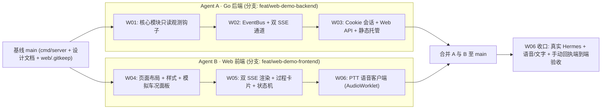

# Web Demo 前端与后端执行过程 SSE 实施任务拆分

> 对应设计文档：[web-demo-interface-design.md](./web-demo-interface-design.md)
> 既有车控契约：[vehicle-contract.md](./vehicle-contract.md) · [hermes-vehicle-task-implementation-plan.md](./hermes-vehicle-task-implementation-plan.md)

本文档将「Web Demo 页面 + 后端 SSE 执行过程推送 + 语音/文字统一交互」拆分为 **W01–W06 共 6 张任务卡**，分配给 **2 个并行 Agent** 执行。分工设计保证文件所有权完全隔离，两位 Agent 可基于同一 `main` 基线并行开发、独立自测，再一次性合入联调。

---

## 1. 两个 Agent 的分工与文件所有权

| 负责人 | 角色定位 | 负责任务卡 | 独占文件范围（严禁越界修改） |
| --- | --- | --- | --- |
| **Agent A** | 后端事件流、观测埋点与 Web API（Go） | **W01、W02、W03** | `vehicle/turns/*`、`vehicle/runs/*`、`vehicle/mcp/*`、`vehicle/executor/*`、`vehicle/catalog/catalog.go`、`voice/gateway/*`、`cmd/server/*.go` |
| **Agent B** | Web 前端页面、音频客户端与联调验收（Frontend + E2E） | **W04、W05、W06** | `cmd/server/web/*`（`index.html`、`style.css`、`app.js`、`voice-client.js`、`pcm-worklet.js`）、`scripts/mock-web-api.py`（可选本地开发 Mock）、`doc/tasks/web-demo-verification.md` |

### 零冲突防撞约定

1. **基线准备**：双方均从包含 `cmd/server` Demo 底座、设计文档以及空占位文件 `cmd/server/web/.gitkeep` 的同一 `main` 提交切出各自工作分支（如 `feat/web-demo-backend` 与 `feat/web-demo-frontend`）。
2. **`embed.FS` 防冲突**：Agent A 使用 `//go:embed web` 并同时提供 `-web-dir` 磁盘覆盖目录；因为 `cmd/server/web/.gitkeep` 已存在，Agent A 无需创建任何 HTML/JS 文件即可通过 `go build`/`go test`，与 Agent B 新增的 `cmd/server/web/*` 零冲突。
3. **契约冻结优先**：任何字段名、SSE `event` 名或错误码调整必须先更新 [web-demo-interface-design.md](./web-demo-interface-design.md) 并同步双方，不得私自偏离。

---

## 2. 冻结共享契约（双方必须严格一致）

1. **鉴权与会话**：`POST /api/session` 签发 `HttpOnly; SameSite=Strict` Cookie（`vehicle_demo_session`），覆盖 `GET /api/events/stream`、`GET /voice/audio`、`POST /voice/utterances` 及所有 `/api/*`、`/debug/*`；同时 100% 保留原有 `Authorization: Bearer <token>`（不破坏 `cmd/car-sim` 与 `curl`）。
2. **会话级过程 SSE（`GET /api/events/stream`）**：
   - 支持 `?session_id=...&vehicle_id=...&after=<seq>` 与请求头 `Last-Event-ID`；
   - 固定 6 类事件名：`process.step`、`message.upsert`、`task.updated`、`vehicle.result`、`telemetry.updated`、`ping`（以及缓冲溢出时的 `stream.reset`）；
   - 每条 `process.step` 携带单调 `seq`、`turn_id`、`request_id`、`run_id`、`task_id`、`command_id`、`channel` 与 `step{step_id, stage, title, status, started_at, finished_at, duration_ms, duration_kind, detail, observation}`。
3. **Hermes 事件归并口径**：
   - Go 通过 `GET /v1/runs/{run_id}/events` 获取 Hermes 主动下发的 `tool.started` / `tool.completed` / `run.*`，通过 `POST /mcp` 获取未截断的完整入参、护栏结果与业务 ID；
   - 前端只订阅 Go 的 `GET /api/events/stream`（及单轮 `POST /voice/utterances`），不直连 Hermes；前后端按 `(turn_id, step.step_id)` 幂等合并。
4. **单轮文字流式 SSE（`POST /voice/utterances`）**：保持 `text/event-stream`，流式推送 `event: process.step`，终态仍输出权威 `event: speech.reply`（异常输出 `event: turn.error`），支持 `?include_steps=0` 兼容关闭。
5. **语音 WebSocket（`GET /voice/audio`）**：严格复用 [vehicle-contract.md](./vehicle-contract.md#车端-websocket) 的 PTT 帧格式（`session.open` / `session.ready` / `speech.started` / `audio.input` 16 kHz / `speech.ended` / `playback.*` 24 kHz / `playback.ack`）。
6. **脱敏红线**：SSE 与所有 `/api/*` 响应严禁包含 `turn_handle`、`X-Vehicle-Turn-Handle`、`Authorization`、`DASHSCOPE_API_KEY`、`HERMES_API_KEY`、`VEHICLE_MCP_SERVICE_TOKEN` 与 Cookie 原值。

---

## 3. 并行推进与合入顺序

---

## 4. 可直接分派的任务卡（W01–W06）

### Agent A 任务卡（Go 后端）

#### W01：核心模块只读观测钩子与能力目录导出

- **归属**：Agent A
- **修改范围**：
  - `vehicle/runs/client.go`：在 `stream()` 解析 Hermes `GET /v1/runs/{run_id}/events` 时，通过可选回调 `OnStreamEvent func(runID, eventType string, raw json.RawMessage)` 透传 `tool.started`、`tool.completed`、`subagent.*`、`run.*`；
  - `vehicle/turns/service.go`：新增可选回调 `OnEvent func(TurnEvent)`，在 BM25 召回与待办加载完成（`catalog.recall`）、Hermes Run 启动/结束（`hermes.run`）、权威答复生成（`turn.reply`）节点回调，并附实测耗时与候选列表；
  - `vehicle/mcp/server.go`：在 `Config` 中新增可选 `OnToolCall func(ToolAuditEvent)`，在每次 `tools/call` 开始与结束时发出脱敏参数、业务错误码、写入状态、耗时；
  - `vehicle/executor/worker.go`：新增可选 `OnStage func(StageEvent)`，在命令下发受理（`executor.dispatch`）与收到回执/车况确认（`executor.receipt`）时回调；
  - `voice/gateway/connection.go` / `voice/gateway/gateway.go`：新增可选 `OnEvent func(GatewayEvent)`，在最终转写落地（`voice.asr`）、路由分流（`voice.route`）、语音播报开始/结束（`voice.playback`）时回调；
  - `vehicle/catalog/catalog.go`：新增只读方法 `ListCapabilities(vehicleID string)` 返回当前车型启用的完整能力与 Schema。
- **验收标准**：
  - 所有回调默认 `nil` 时行为零变化；
  - 既有 `go test -race ./vehicle/... ./voice/... ./integration/...` 全部通过（不含无关旧日期测试漂移）；
  - 针对每个新增回调补充单元测试，确认回调触发时机、字段与脱敏正确。

#### W02：Scope 隔离事件总线、脱敏器与双 SSE 通道

- **归属**：Agent A
- **依赖**：W01
- **新增/修改范围**：`cmd/server/events.go`、`cmd/server/events_test.go`、`vehicle/turns/http.go`、`cmd/server/main.go`
- **工作内容**：
  1. 实现 `EventBus`：按 `contract.Scope` 分桶，每个 `Scope` 维护有界环形缓冲（默认 500 条）与单调递增 `seq`，支持多订阅者扇出、慢消费者保护与关闭清理；
  2. 实现统一脱敏器：递归剥离/掩码所有禁止字段（`turn_handle`、Token、API Key 等）；
  3. 实现 `GET /api/events/stream`：支持 `after` 与 `Last-Event-ID` 补发、超窗下发 `event: stream.reset`、15s `event: ping` 心跳及标准防缓冲 SSE 响应头；
  4. 增强 `POST /voice/utterances`：通过 `context` 透传单轮 step sink，边执行边 `Flush()` 推送 `event: process.step`，终态仍输出 `event: speech.reply`（支持 `?include_steps=0`），异常输出 `event: turn.error`；
  5. 接入 W01 的全部钩子，统一发布 `process.step`、`message.upsert`、`task.updated`、`vehicle.result`、`telemetry.updated`。
- **验收标准**：
  - 单元测试验证：事件严格按 `seq` 递增、跨 `Scope` 零串流、`Last-Event-ID` 断点续传、超窗触发 `stream.reset`、脱敏黑名单字段 0 泄露；
  - `POST /voice/utterances` 在两轮关窗场景下先流式收到多个 `process.step`，最后收到完整 `speech.reply`，且旧解析逻辑 100% 兼容。

#### W03：浏览器 Cookie 会话鉴权、Web 查询 API 与静态托管

- **归属**：Agent A
- **依赖**：W02
- **新增/修改范围**：`cmd/server/session.go`、`cmd/server/web_api.go`、`cmd/server/main.go`、`cmd/server/main_test.go`
- **工作内容**：
  1. 实现 `POST /api/session` 与 Cookie 鉴权中间件：签发 `vehicle_demo_session`（`HttpOnly; SameSite=Strict`），在进入 `/voice/audio`、`/voice/utterances`、`/api/*`、`/debug/*` 时无缝解析 `Scope`，同时完全兼容原有 `Authorization: Bearer`；
  2. 实现 `GET /api/config`（探测 Hermes `/health` 并返回就绪态、语音开关、TTS 模式、模拟模式、车型信息、快捷话术）；
  3. 实现 `GET /api/capabilities`（返回 `catalog.ListCapabilities` 结果）；
  4. 实现 `GET /api/state`（返回 `cursor`、`telemetry`、`pending_tasks`、`active_commands`、`vehicle_results`、近期 `messages` 与 `process_steps`）；
  5. 挂载 `GET /` 与 `GET /static/*`（支持 `embed.FS` + `-web-dir` 热加载参数，便于前端开发）。
- **验收标准**：
  - `cmd/server/main_test.go` 覆盖：Cookie 建连后访问 `GET /api/events/stream`、`POST /voice/utterances`、`GET /api/state`、`GET /api/capabilities`、`POST /debug/receipt` 全通；
  - 校验未带 Cookie 且未带 Bearer 时返回 `401`，校验 `cmd/car-sim` 原有 Bearer 路径不受影响；
  - `go test -race ./cmd/server/... && go vet ./... && git diff --check` 全绿。

---

### Agent B 任务卡（Web 前端与联调验收）

#### W04：页面骨架、参考风格样式与模拟车况面板

- **归属**：Agent B
- **参考来源**：`/Users/kirin/Documents/ChatGPT/personal_agent/web/index.html` 与 `style.css`
- **新增范围**：`cmd/server/web/index.html`、`cmd/server/web/style.css`
- **工作内容**：
  1. 沿用 `personal_agent` 低饱和浅绿/暖白配色与排版气质，构建三栏响应式布局（左侧导航与系统状态灯 + 中央对话与过程时间线 + 右侧模拟车辆仪表与回执控制台）；
  2. 实现能力目录抽屉（`<dialog>`，展示能力列表、触发例句一键填入输入框、Schema JSON 预览）；
  3. 实现右侧模拟车辆状态面板：四窗（左前/右前/左后/右后）开闭状态、空调开关与设定温度、待回复任务及过期倒计时、在途指令与 `SIM_MODE=accepted_only` 下的 `[模拟完成]`/`[模拟失败]` 按钮、最近结果事件列表；
  4. 适配窄屏/移动端布局（右侧车况面板可折叠为抽屉）。
- **验收标准**：
  - 零外部 CDN / 零构建依赖，纯静态打开无控制台错误；
  - 桌面端（1440px）与窄屏（≤ 900px）布局无溢出、无遮挡。

#### W05：对话状态机、双 SSE 执行过程渲染与去重计时

- **归属**：Agent B
- **依赖**：W04（在 Agent A 合入前可先用轻量本地 Mock 脚本按冻结契约开发自测）
- **新增范围**：`cmd/server/web/app.js`（可选辅助测试脚本 `scripts/mock-web-api.py`）
- **工作内容**：
  1. 初始化链路：`POST /api/session` → `GET /api/config` + `GET /api/capabilities` + `GET /api/state` → 建立 `EventSource("/api/events/stream?after=<cursor>")`；
  2. 断线恢复：监听 `stream.reset` 与 `onerror`，自动指数退避重连并调用 `GET /api/state` 补齐状态；
  3. 文字输入：通过 `fetch("/voice/utterances")` 流式读取 SSE（解析 `process.step`、`speech.reply`、`turn.error`），并按 `(turn_id, step.step_id)` 与 `/api/events/stream` 幂等合并；
  4. 执行过程卡片（参考 `personal_agent` 的 `.process`）：
     - 执行中自动展开，100ms 实时刷新运行中步骤计时器；
     - 展示 9 类阶段图标、实测耗时、`duration_kind` 标注，支持点击展开格式化 JSON（`observation.input`/`output`/`error_code`）；
     - 正确锚定在对应用户消息与助手最终回复之间，重排时保持滚动条不跳动；
  5. 联动右侧模拟车辆面板（消费 `telemetry.updated`、`task.updated`、`vehicle.result`，支持点击手动注入 `POST /debug/receipt`）及输入框上方的待办上下文提示条。
- **验收标准**：
  - 模拟并发推送与重复 `seq` 时不出现重复气泡或重复步骤；
  - 断网重连后时间线与车况自动同步恢复；
  - 追问 → 补参 → 下发 → 车辆回执全流程的每一步与实测耗时清晰可见。

#### W06：浏览器 PTT 语音客户端（AudioWorklet）与全链路联调验收

- **归属**：Agent B（需在 Agent A 合入 `main` 后完成最终真实联调）
- **依赖**：W05 + Agent A（W01–W03）
- **新增范围**：`cmd/server/web/pcm-worklet.js`、`cmd/server/web/voice-client.js`、`doc/tasks/web-demo-verification.md`
- **工作内容**：
  1. 实现 `pcm-worklet.js`：实时将麦克风采样重采样为 **16 kHz 单声道 PCM16LE** 帧；
  2. 实现 `voice-client.js`：严格按 `GET /voice/audio` PTT 协议实现 `session.open` / `session.ready` / `speech.started` / 递增 `sequence` 的 `audio.input`（50–100ms 分片 Base64）/ `speech.ended` / 下行 24 kHz Web Audio 队列播放 / 播完回发 `playback.ack`；
  3. 实现打断与异常态：播报期间起讲立即停播并发送新 `speech.started`；处理 `session.reconnecting` 代数刷新；未配置 `DASHSCOPE_API_KEY` 时置灰语音按钮并提示原因；
  4. **最终端到端联调验收**（合入 Agent A 代码后实跑 `./scripts/start-demo.sh`）：
     - 场景 1（文字两轮关窗）：「把车窗关一下」→ 查看实时 SSE 过程与追问 →「左后窗」→ 查看 MCP 下发、执行器回执与右侧车窗变 `closed`；
     - 场景 2（语音两轮关窗 + 闲聊）：连接 `/voice/audio` 完成语音转写气泡、实时过程卡片、追问播报与结果播报；
     - 场景 3（`SIM_MODE=accepted_only` 两阶段回执）：下发停在 `executing`，在右侧点击 `[模拟完成]` 观察 SSE 推送回执、车况变化与结果气泡；
     - 输出验收文档 `doc/tasks/web-demo-verification.md`（记录验证步骤、脱敏事件样例与检查结果）。

---

## 5. 可直接发给两个 Agent 的分派指令

### 发给 Agent A（Go 后端）

> 请阅读 [doc/design/web-demo-interface-design.md](./web-demo-interface-design.md) 和 [doc/design/web-demo-implementation-plan.md](./web-demo-implementation-plan.md)，负责完成任务卡 **W01、W02、W03**。
>
> - 分支建议：`feat/web-demo-backend`（从最新 `main` 切出）。
> - 只修改后端 Go 文件（`vehicle/*`、`voice/gateway/*`、`cmd/server/*.go`），**不要修改** `cmd/server/web/` 下的前端页面文件（由 Agent B 负责）。
> - 重点保证：
>   1. 既有 H00–H09 契约、`cmd/car-sim` 的 Bearer 鉴权以及原有单测零破坏；
>   2. `GET /api/events/stream`（含 `Last-Event-ID` 续传、`stream.reset`、`ping`）与 `POST /voice/utterances`（流式 `process.step` + 终态 `speech.reply`）严格遵守设计文档字段；
>   3. Hermes `GET /v1/runs/{run_id}/events` 与 Go `POST /mcp` 的过程事件均经脱敏后进入按 `Scope` 隔离的 EventBus，严禁泄露 `turn_handle`、Token 或 API Key；
>   4. 提供 `POST /api/session`（`HttpOnly; SameSite=Strict` Cookie）、`GET /api/config`、`GET /api/capabilities`、`GET /api/state` 及静态托管（支持 `-web-dir` 覆盖）。
> - 交付：独立 PR、完整单元测试，以及 `go test -race ./cmd/server/... ./vehicle/turns/... ./vehicle/runs/... ./vehicle/mcp/... ./vehicle/catalog/... ./voice/gateway/... && go vet ./... && git diff --check` 通过证据。

### 发给 Agent B（Web 前端与联调验收）

> 请阅读 [doc/design/web-demo-interface-design.md](./web-demo-interface-design.md) 和 [doc/design/web-demo-implementation-plan.md](./web-demo-implementation-plan.md)，并参考 `/Users/kirin/Documents/ChatGPT/personal_agent/web/` 的视觉风格与音频处理方式，负责完成任务卡 **W04、W05、W06**。
>
> - 分支建议：`feat/web-demo-frontend`（从最新 `main` 切出）。
> - 只修改 `cmd/server/web/*`（及可选开发态 Mock 脚本与 `doc/tasks/web-demo-verification.md`），**不要修改**后端 Go 源码（由 Agent A 负责）。
> - 重点保证：
>   1. 零前端构建依赖（原生 HTML/CSS/ESM + AudioWorklet），页面同时支持文字输入、PTT 语音交互、折叠式实时执行过程卡片（含实时计时器、耗时类型标注与可展开 JSON 观测数据）以及右侧模拟车况与手动回执控制台；
>   2. 严格按设计文档对接 `POST /api/session`、`GET /api/events/stream`、`POST /voice/utterances`（按 `(turn_id, step.step_id)` 幂等去重）、`GET /api/state`、`GET /api/capabilities`、`POST /debug/receipt`；
>   3. `voice-client.js` 严格实现本项目的 `GET /voice/audio` PTT 帧协议（16 kHz 上行 / 24 kHz 下行 + `playback.ack` + 打断停播），不要照搬参考项目的连续流 `/ws/voice` 协议；
>   4. Agent A 合入 `main` 后，rebase 并运行 `./scripts/start-demo.sh` 完成文字、语音及 `SIM_MODE=accepted_only` 手动回执三类场景的端到端实测验收，输出 `doc/tasks/web-demo-verification.md`。
