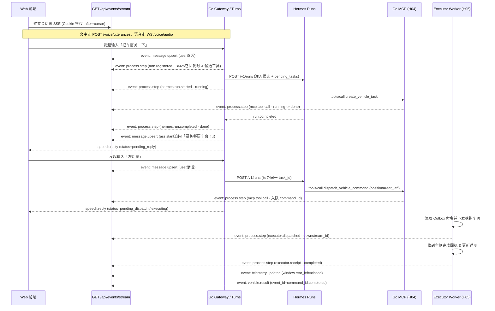

# Web Demo 前端页面与后端执行过程 SSE 接口设计

> 本文档面向 `app_personal_agent` Demo 阶段，参考同源项目 `personal_agent` 的交互与过程展示思路，设计一套**零前端构建依赖、支持语音与文字双入口、并通过后端 SSE 实时推送全链路执行过程**的前后端接口与页面方案。
>
> 相关既有契约：[vehicle-contract.md](./vehicle-contract.md) · [hermes-vehicle-task-design.md](./hermes-vehicle-task-design.md) · [README.md](../../README.md)

---

## 1. 设计目标与边界

### 1.1 核心目标

1. **语音 + 文字统一交互**：浏览器内可直接文字对话，也可使用麦克风进行语音交互并播放 24 kHz 语音回复，两类输入汇聚到同一条时间线。
2. **后端 SSE 实时返回执行过程**：每轮从「语音转写 / 分流 → BM25 召回 → Hermes 推理 → Go MCP 工具调用与护栏校验 → 任务入库 → 模拟车辆执行器下发 → 车辆回执确认 → 车况刷新」的真实步骤与实测耗时，均由后端通过 SSE 实时推送前端渲染。
3. **100% 兼容既有契约与 CLI**：不破坏现有 `cmd/car-sim`、`POST /voice/utterances`、H00–H09 共享接口及 Go 写入安全边界；`turn_handle`、API Key、Service Token 等敏感凭据绝不进入 SSE 或前端响应。
4. **Demo 阶段极简交付**：前端使用原生 HTML + CSS + ES Modules + `AudioWorklet`（由 Go `embed.FS` 内嵌进 [cmd/server](../../cmd/server/main.go) 直接托管），无需 Node.js / Vite 构建链。

### 1.2 非目标（本期不做）

- 多设备配对码 / 移动端跨设备接管（`personal_agent` 中的手机配对功能）；
- 周期定时计划调度与复杂改口/追加（待架构优化路线图 P2 阶段落地）；
- 能力目录的在线导入/编辑（本期提供只读能力浏览与 Schema 查看）。

---

## 2. 整体交互架构

### 2.1 三通道协同模型

```mermaid
flowchart LR
    subgraph Browser["Web Demo 前端 (原生 ESM + AudioWorklet)"]
        UI["统一对话时间线与执行过程卡片"]
        MIC["麦克风采集 (16 kHz PCM16LE) / 播放器 (24 kHz)"]
        PANEL["模拟车况与回执面板"]
    end

    subgraph GoServer["Go Demo Server (cmd/server)"]
        AUTH["会话鉴权 (Cookie / Bearer)"]
        TEXT["POST /voice/utterances (单轮文字 SSE)"]
        VOICE["GET /voice/audio (既有车端 WebSocket)"]
        SSE["GET /api/events/stream (会话级过程 SSE)"]
        BUS["Scope 隔离事件总线 (环形缓冲 + seq)"]
        API["REST: /api/session, /api/config, /api/state, /api/capabilities, /debug/receipt"]
        CORE["turns.Service + catalog + mcp.Server + executor.Worker"]
    end

    subgraph External["外部运行时"]
        QWEN["百炼 Qwen Realtime"]
        HERMES["Hermes Gateway (Runs API)"]
    end

    UI -->|1. 初始化会话与快照| API
    UI <-->|2. 订阅会话级 SSE| SSE
    UI -->|3. 文字发送 (流式 SSE)| TEXT
    MIC <-->|4. 语音收发 (PTT WebSocket)| VOICE
    PANEL <-->|5. 车况查询 / 手动回执| API

    AUTH --- TEXT
    AUTH --- VOICE
    AUTH --- SSE
    AUTH --- API

    TEXT --> CORE
    VOICE <--> QWEN
    VOICE --> CORE
    CORE <--> HERMES
    CORE -->|实时发布各阶段事件| BUS
    VOICE -->|发布转写/分流/播报事件| BUS
    BUS -->|推送 process.step / message / telemetry| SSE
    BUS -.->|同步透传当前轮次 step| TEXT
```

### 2.2 为什么同时设计「单轮 SSE」与「会话级 SSE」

| 通道 | 接口 | 职责与必要性 |
| --- | --- | --- |
| **会话级总流 SSE（主通道）** | `GET /api/events/stream` | **覆盖全场景**：语音轮次（经 WS 触发）无独立 HTTP 响应流；且车辆命令由 `executor.Worker` 异步执行并在请求返回后才收到回执。会话级 SSE 持续推送语音过程、文字过程、异步执行器回执与车况变化，支持 `Last-Event-ID` 断线续传。 |
| **单轮文字流式 SSE（增强兼容）** | `POST /voice/utterances` | **直接面向文字接口调用方**：在既有 `text/event-stream` 响应中，先流式吐出本轮的 `event: process.step`，最后仍输出权威 `event: speech.reply`。无论是 `curl -N` 还是前端 `fetch` 流式读取都能实时看到本轮过程，且完全向后兼容只解析 `speech.reply` 的旧调用方。 |
| **车端语音 WebSocket（复用既有）** | `GET /voice/audio` | **复用 H00/H08 既有协议**：继续使用 `session.open` / `speech.started` / `audio.input` / `speech.ended` / `playback.*` 帧格式，避免维护两套语音协议。 |

### 2.3 典型时序：语音/文字两轮关窗与实时过程推送



---

## 3. 认证与浏览器兼容方案

### 3.1 问题背景

浏览器原生 `EventSource` 和 `WebSocket` API **不支持自定义 `Authorization: Bearer ...` 请求头**，且不应将长期 Token 放入 URL Query（易泄露于访问日志和历史记录）。

### 3.2 统一双模式鉴权设计

在 [cmd/server](../../cmd/server/main.go) 中间件层增加轻量 Cookie 映射，**保持底层 `gateway.Gateway`、`turns.UtteranceHandler` 与 `contract.Authenticator` 接口不变**：

1. **CLI / API 客户端（原有方式，完全兼容）**：继续携带 `Authorization: Bearer <DEMO_AUTH_TOKEN>`。
2. **浏览器前端（Cookie 会话）**：
   - 页面加载后调用 `POST /api/session`（Demo 模式默认自动签发，若开启口令校验则由前端弹窗输入一次 Token 换取 Cookie）；
   - 服务端下发 `Set-Cookie: vehicle_demo_session=<opaque_id>; Path=/; HttpOnly; SameSite=Strict`；
   - 浏览器发起 `GET /api/events/stream`、`GET /voice/audio`、`POST /voice/utterances` 等同源请求时自动附带该 Cookie；
   - Go 服务端在鉴权层按「优先 `Authorization: Bearer`，其次 `vehicle_demo_session` Cookie」解析可信 `contract.Scope`。

---

## 4. 接口总览清单

| 分类 | 方法与路径 | 协议 | 鉴权 | 状态 | 说明 |
| --- | --- | --- | --- | --- | --- |
| **静态页面** | `GET /`、`GET /static/*` | HTTP | 无 | 新增 | 托管内嵌 Web Demo（`index.html`、`style.css`、`app.js`、`voice-client.js`、`pcm-worklet.js`） |
| **会话与配置** | `POST /api/session` | JSON | Demo / Bearer | 新增 | 建立/续期浏览器会话，签发 `HttpOnly` Cookie，返回 `session_id`、`vehicle_id`、`user_id` |
| **会话与配置** | `GET /api/config` | JSON | Cookie / Bearer | 新增 | 返回系统就绪状态（Hermes 健康、语音开关、TTS 模式、模拟车辆模式、当前车型、快捷示例） |
| **能力目录** | `GET /api/capabilities` | JSON | Cookie / Bearer | 新增 | 返回当前车型启用的能力目录与参数 Schema（供左侧「能力目录」抽屉与 Schema 预览） |
| **状态快照** | `GET /api/state` | JSON | Cookie / Bearer | 新增 | 首屏加载与断线重连兜底快照：车况遥测、待回复任务、历史结果、近期消息与过程步骤、`cursor` |
| **执行过程 SSE** | `GET /api/events/stream` | **SSE** | Cookie / Bearer | **新增（核心）** | 会话级实时事件流：推送 `process.step`、`message.upsert`、`telemetry.updated`、`vehicle.result`、`ping` |
| **文字对话 SSE** | `POST /voice/utterances` | **SSE** | Cookie / Bearer | **增强（兼容）** | 提交文字指令；执行期间流式推送 `process.step`，终态推送权威 `speech.reply` |
| **语音 WebSocket** | `GET /voice/audio` | **WebSocket** | Cookie / Bearer | **复用既有** | 车端 PTT 实时语音通道（16 kHz 上行 / 24 kHz 下行 PCM16LE） |
| **健康检查** | `GET /healthz` | JSON | 无 | 既有 | 服务存活与运行模式摘要 |
| **模拟回执** | `POST /debug/receipt` | JSON | Cookie / Bearer | 既有 | `SIM_MODE=accepted_only` 时手动注入车辆 `completed` / `failed` 回执 |

---

## 5. 核心接口详细设计

### 5.1 `POST /api/session` — 初始化浏览器会话

**请求体**（均可选，缺省使用服务端默认 Demo 配置）：

```json
{
  "session_id": "web-demo-01",
  "vehicle_id": "sim-car",
  "token": "demo-token"
}
```

> 说明：仅当未持有有效 Cookie 且未带 `Authorization` 头时，允许在首帧 JSON 中携带 `token`（生产环境可替换为真实登录态）；Demo 默认配置下前端可自动完成无感建连。

**响应（`200 OK` + `Set-Cookie`）**：

```json
{
  "user_id": "demo-user",
  "session_id": "web-demo-01",
  "vehicle_id": "sim-car",
  "cursor": 0
}
```

---

### 5.2 `GET /api/config` — 运行时配置与健康状态

**响应（`200 OK`）**：

```json
{
  "storage": "sqlite",
  "hermes_url": "http://127.0.0.1:8642",
  "hermes_ready": true,
  "voice_enabled": true,
  "tts_backend": "say",
  "sim_mode": "auto_complete",
  "debug_enabled": true,
  "default_vehicle": {
    "vehicle_id": "sim-car",
    "model": "EV-SUV-2026",
    "manual_version": "2026.1",
    "min_temp_c": 16,
    "max_temp_c": 32
  },
  "suggestions": [
    "把车窗关一下",
    "打开空调调到24度",
    "左后窗关了吗",
    "儿童锁怎么用"
  ]
}
```

---

### 5.3 `GET /api/events/stream` — 会话级执行过程 SSE（核心）

**请求参数**

| 参数 / 头 | 位置 | 必填 | 说明 |
| --- | --- | --- | --- |
| `session_id` | Query | 否 | 缺省取当前 Cookie 会话绑定的 `session_id` |
| `vehicle_id` | Query | 否 | 缺省取当前 Cookie 会话绑定的 `vehicle_id` |
| `after` | Query | 否 | 上次消费的事件序号（整数 `seq`，默认 `0`） |
| `Last-Event-ID` | Header | 否 | 浏览器 `EventSource` 自动重连时携带，优先级高于 `after` |

**响应头**

```http
Content-Type: text/event-stream; charset=utf-8
Cache-Control: no-store
Connection: keep-alive
X-Accel-Buffering: no
```

**SSE 帧格式规范**

每条事件均携带单调递增整数 `id`（作用域内唯一序号）、明确的 `event` 类型与 JSON `data`：

```text
id: 42
event: process.step
data: {"seq":42,"ts":"2026-11-28T09:45:12.318Z","scope":{"user_id":"demo-user","session_id":"web-demo-01","vehicle_id":"sim-car"},"turn_id":"text-a1b2...","request_id":"req-101","run_id":"run_8dbc...","task_id":"T136475624C00E4EB","command_id":"","channel":"text","step":{"step_id":"mcp:1","stage":"mcp_tool","title":"调用车控工具 create_vehicle_task","status":"done","started_at":"2026-11-28T09:45:12.290Z","finished_at":"2026-11-28T09:45:12.318Z","duration_ms":28,"duration_kind":"measured_tool","observation":{"action":"create_vehicle_task (window.close)","input":{"device":"window","tool":"close","params":{}},"output":{"status":"pending_reply","task_id":"T136475624C00E4EB","missing_fields":["position"],"question":"要关哪扇车窗？"}}}}

id: 43
event: ping
data: {"ts":"2026-11-28T09:45:27.000Z"}
```

#### 5.3.1 统一事件类型定义

| `event` 名称 | 触发时机 | 前端处理方式 |
| --- | --- | --- |
| `process.step` | 任一执行阶段开始、更新或完成 | 按 `(turn_id, step.step_id)` 幂等 upsert 到对应轮次的「处理过程」折叠卡片；`status=running` 时启动实时计时器，`done/error` 时定格为后端实测 `duration_ms` |
| `message.upsert` | 用户发出文字、语音最终转写落地、助手答复（闲聊/追问/处理中/查询回复）生成 | 按 `message_id` 幂等插入或更新对话气泡（区分 `role: user/assistant`、`channel: text/voice`） |
| `task.updated` | 任务进入 `pending_reply`、`pending_dispatch`、`executing`、`completed`、`failed`、`expired` | 更新顶部待办任务提示条（`pending_tasks`）、任务计数及对应卡片状态徽标 |
| `vehicle.result` | H05 产生权威结果事件（`command_id:completed/failed/result_unknown`） | 追加权威结果气泡（「车窗已关闭。」等），并标记对应执行过程卡片已确认完成 |
| `telemetry.updated` | 模拟车辆执行成功或初始化/刷新车况 | 实时更新右侧模拟车况面板（四窗状态、空调开关/温度） |
| `ping` | 每 15 秒无事件时发送保活心跳 | 维持代理/浏览器长连接活跃，不渲染 UI |

#### 5.3.2 `process.step` 数据结构（JSON Schema 约定）

```json
{
  "seq": 42,
  "ts": "2026-11-28T09:45:12.318Z",
  "scope": {
    "user_id": "demo-user",
    "session_id": "web-demo-01",
    "vehicle_id": "sim-car"
  },
  "turn_id": "text-d77de244...",
  "request_id": "req-101",
  "run_id": "run_1f7f725b...",
  "task_id": "T136475624C00E4EB",
  "command_id": "C2B12CD3BB2957CA1",
  "channel": "text",
  "step": {
    "step_id": "mcp:create_vehicle_task:1",
    "stage": "mcp_tool",
    "title": "调用车控工具 create_vehicle_task",
    "status": "running",
    "started_at": "2026-11-28T09:45:12.290Z",
    "finished_at": null,
    "duration_ms": null,
    "duration_kind": "measured_tool",
    "detail": "window.close · 校验参数并创建待回复任务",
    "observation": {
      "action": "create_vehicle_task",
      "input": { "device": "window", "tool": "close", "params": {} },
      "output": null,
      "error_code": ""
    }
  }
}
```

字段枚举约定：
- `channel`：`"text"` | `"voice"` | `"executor"`
- `step.status`：`"running"` | `"done"` | `"waiting"` | `"error"` | `"interrupted"`
- `step.duration_kind`（借鉴 `personal_agent` 的可信耗时标注）：
  - `"measured_local"`：Go 本地实测（如 BM25 召回、路由分流）
  - `"measured_tool"`：Go MCP 工具执行实测（含写锁、护栏校验、SQLite 事务）
  - `"boundary_wait"`：外部边界等待区间（如 Qwen 转写、Hermes + 大模型推理、模拟车辆执行等待）
  - `"instant"`：瞬时状态事件（如取消、打断）

#### 5.3.3 全链路 `step.stage` 枚举与展示文案

| 序号 | `step.stage` | 适用入口 | 中文标题示例 | 关键观测数据（`observation`） |
| --- | --- | --- | --- | --- |
| 1 | `voice.asr` | 语音 | 语音转写（Qwen Realtime） | 最终转写文本 `transcript`、音频字节数、转写耗时 |
| 2 | `voice.route` | 语音 | 语音分流判定 | `route`（`native_s2s` / `vehicle_hermes`）、活跃待办数 `pending_count` |
| 3 | `catalog.recall` | 文字 / 语音 | BM25 能力预筛与待办加载 | 召回候选工具列表 `candidate_tools`、注入的 `pending_tasks` 数量 |
| 4 | `hermes.run` | 文字 / 语音 | Hermes 意图理解与编排 | `run_id`、Run 终态（`completed`/`failed`/`cancelled`）、总耗时 |
| 5 | `mcp.tool` | 文字 / 语音 | 调用 MCP 工具 `<tool_name>` | 工具入参 `input`（脱敏）、Go 护栏与校验结果 `output` / `error_code` |
| 6 | `turn.reply` | 文字 / 语音 | 权威状态核验与答复生成 | 最终批准状态（`pending_reply` / `pending_dispatch` / 只读回复）、答复文本 |
| 7 | `executor.dispatch` | 异步车控 | 车辆指令下发（Outbox Worker） | `command_id`、`downstream_id`、`device.tool`、`params` |
| 8 | `executor.receipt` | 异步车控 | 车辆执行回执确认 | `event_id`、终态（`completed` / `failed` / `result_unknown`）、对账方式（回执/车况） |
| 9 | `voice.playback` | 语音 | 语音播报输出（TTS / S2S） | `playback_id`、播报来源（`native` / `reply` / `result`）、音频时长 |

#### 5.3.4 断线重连与防丢策略

- 服务端事件总线按 `Scope` 维护有界环形缓冲（默认保留最近 **500** 条事件，单调递增 `seq`）。
- 前端重连时带 `Last-Event-ID`（或 `after`）：
  - 若 `after` 仍在环形缓冲窗口内，服务端直接重放缺失事件后无缝切入实时订阅；
  - 若 `after` 已被淘汰（例如断网过久或服务重启），服务端先发送一条 `event: stream.reset`（携带最新 `cursor`），前端自动调用 `GET /api/state` 同步全量快照后再续订。

---

### 5.4 `POST /voice/utterances` — 单轮文字流式 SSE（向后兼容增强）

**请求方式（保持与 [vehicle/turns/http.go](../../vehicle/turns/http.go) 一致）**

```http
POST /voice/utterances
Content-Type: application/json
Accept: text/event-stream
```

```json
{
  "session_id": "web-demo-01",
  "vehicle_id": "sim-car",
  "request_id": "req-1732786910-1",
  "text": "把车窗关一下"
}
```

**流式响应行为**

1. 服务端立即返回 `200 OK` + `Content-Type: text/event-stream; charset=utf-8` + `X-Accel-Buffering: no`，并在校验通过后立即 `Flush()`。
2. 在本轮执行过程中，每产生一个属于当前 `request_id` 的 `process.step`（`catalog.recall` → `hermes.run` → `mcp.tool` → `turn.reply`），立即以 `event: process.step` 推送并 `Flush()`：
   ```text
   id: req-101:step:1
   event: process.step
   data: {"turn_id":"...","request_id":"req-101","step":{...}}

   id: req-101:step:2
   event: process.step
   data: {"turn_id":"...","request_id":"req-101","step":{...}}

   id: d77de244...
   event: speech.reply
   data: {"voice_turn_id":"...","request_id":"req-101","run_id":"...","task_id":"...","status":"pending_reply","text":"要关哪扇车窗？"}
   ```
3. **错误处理**：
   - 请求入参/鉴权错误（启动前失败）：仍返回对应 HTTP `400` / `401` / `403` JSON 错误；
   - 流已开始后的业务或上游异常：输出 `event: turn.error`（含 `BusinessError` 的 `code` 与 `message`）后关闭流。
4. **向后兼容性**：
   - 既有单测与 `curl` 消费者按 `event: speech.reply` 或末尾 `data:` 解析 `contract.SpeechReply` 的逻辑保持完全兼容（可通过可选 Query `?include_steps=0` 关闭中间过程事件，默认 `1` 开启）。
   - 前端若同时开启了 `GET /api/events/stream`，以 `(turn_id, step.step_id)` 幂等去重，防止重复条目。

---

### 5.5 `GET /voice/audio` — 浏览器语音 WebSocket（复用既有车端协议）

直接复用 [doc/design/vehicle-contract.md](./vehicle-contract.md#车端-websocket) 定义的协议，前端实现为 **PTT（按住说话 / 点击开始与结束说话）**：

1. **建连协商**：
   - `new WebSocket("ws(s)://" + location.host + "/voice/audio")`（通过 `HttpOnly` Cookie 鉴权）
   - 发送：`{"type":"session.open","session_id":"...","vehicle_id":"sim-car","input_format":{"encoding":"pcm_s16le","sample_rate":16000,"channels":1}}`
   - 接收：`session.ready` → 保存 `connection_generation`
2. **采集与发送（复用参考项目 `pcm-worklet.js` 思路）**：
   - 使用 `AudioWorklet`（`pcm-capture`）将浏览器任意采样率（44.1/48 kHz）实时线性重采样为 **16 kHz 单声道 PCM16LE**；
   - 点击「按住说话 / 开始说话」：停止当前本地播放，生成唯一 `voice_turn_id`，发送 `speech.started`；
   - 每累积 1600–3200 字节（50–100 ms）Base64 编码后按递增 `sequence` 发送 `audio.input`；
   - 松开 / 点击「结束说话」：发送 `speech.ended`。
3. **下行播报与回执**：
   - 收到 `speech.reply` / `vehicle.result`：更新对应轮次状态（同时会话级 SSE 也会推送完整 `process.step` 与消息）；
   - 收到 `playback.start` → 连续 `audio.output`（24 kHz 单声道 PCM16LE Base64）→ `playback.stop`：使用 Web Audio `AudioBufferSourceNode` 顺滑拼接播放；
   - 播放完成（`playback.stop` 且本地缓冲区播完）后回发 `playback.ack`（`playback_id`, `playback_generation`）。
4. **打断与重连**：
   - 播放中用户再次起讲：立即停止所有本地 `AudioBufferSourceNode`，发送新 `speech.started`；服务端停止旧播报但不取消已入库车控指令；
   - 若服务端下发 `session.reconnecting` / `session.ready`：更新 `connection_generation` 并提示用户重新说话。

---

### 5.6 `GET /api/state` 与 `GET /api/capabilities`

#### `GET /api/state?session_id=...&vehicle_id=...`（首屏与断线恢复快照）

```json
{
  "cursor": 48,
  "scope": { "user_id": "demo-user", "session_id": "web-demo-01", "vehicle_id": "sim-car" },
  "telemetry": {
    "window.front_left": { "Value": "closed", "SampledAt": "2026-11-28T09:45:00Z", "Available": true },
    "window.rear_left":  { "Value": "open",   "SampledAt": "2026-11-28T09:45:00Z", "Available": true },
    "hvac.power":        { "Value": "off",    "SampledAt": "2026-11-28T09:45:00Z", "Available": true },
    "hvac.temperature_c":{ "Value": 24,       "SampledAt": "2026-11-28T09:45:00Z", "Available": true }
  },
  "pending_tasks": [
    {
      "task_id": "T136475624C00E4EB",
      "version": 1,
      "device": "window",
      "tool": "close",
      "known_params": {},
      "missing_fields": ["position"],
      "question": "要关哪扇车窗？",
      "created_at": "2026-11-28T09:45:12Z",
      "expires_at": "2026-11-28T09:55:12Z"
    }
  ],
  "active_commands": [
    {
      "command_id": "C2B12CD3BB2957CA1",
      "task_id": "T136475624C00E4EB",
      "device": "window",
      "tool": "close",
      "params": { "position": "rear_left" },
      "status": "executing",
      "downstream_id": "VEH-0001"
    }
  ],
  "vehicle_results": [],
  "messages": [],
  "process_steps": []
}
```

> 注：`active_commands` 供右侧模拟面板在 `SIM_MODE=accepted_only` 模式下直接渲染「模拟成功回执 / 模拟失败回执」一键按钮（点击调用既有 `POST /debug/receipt`）。

#### `GET /api/capabilities?vehicle_id=sim-car`

返回当前车型的所有已启用能力列表（来自 `vehicle/catalog`），包含 `device`、`tool`、`mcp_tool`、`description`、`aliases`、`utterances` 与 `params_schema`，供左侧「能力目录」抽屉展示与一键填入示例话术。

---

## 6. 后端观测埋点与安全脱敏规范

### 6.1 无侵入扩展点设计

为了把真实执行过程无侵入地注入事件总线，各模块仅增加轻量只读观察回调（默认 `nil`，零性能与行为侵入）：

| 模块 | 扩展点 | 发布的事件 |
| --- | --- | --- |
| `voice/gateway` | 新增可选 `OnEvent func(GatewayEvent)` 回调 | `voice.asr`（最终转写）、`voice.route`（分流决策）、`voice.playback`（播报开始/结束） |
| `vehicle/turns` | `Service` 新增可选 `OnEvent func(TurnEvent)` 回调（并支持从 `context.Context` 透传单轮 sink 给 `POST /voice/utterances`） | `catalog.recall`（BM25 召回候选与待办）、`hermes.run`（开始/结束）、`turn.reply`（权威批准答复） |
| `vehicle/runs` | `Client` 新增可选 `OnStreamEvent func(runID, eventType string, raw json.RawMessage)` | 透传 Hermes 原生 `tool.started` / `tool.completed` 进度（与 Go MCP 实测事件互补） |
| `vehicle/mcp` | `Config` 新增可选 `OnToolCall func(ToolAuditEvent)` 回调 | `mcp.tool`（每次真实 MCP 工具调用的开始/结束、耗时、脱敏参数、业务状态码与结果） |
| `vehicle/executor` | 复用已有 `Worker.OnEvent` + 新增可选 `OnStage func(StageEvent)` | `executor.dispatch`（下发受理）、`executor.receipt`（完成/失败回执）、`telemetry.updated` |

### 6.2 严格安全脱敏规则

所有进入 `ProcessEvent` / `GET /api/events/stream` / `POST /voice/utterances` 的数据必须经过统一脱敏函数：
- **严禁输出**：`turn_handle`、`X-Vehicle-Turn-Handle`、`Authorization`、`DASHSCOPE_API_KEY`、`HERMES_API_KEY`、`VEHICLE_MCP_SERVICE_TOKEN`、原始 Cookie 值、数据库 DSN；
- **允许输出**：`turn_id`、`request_id`、`run_id`、`task_id`、`command_id`、`downstream_id`、`event_id`、业务参数（`device`/`tool`/`params`）、业务错误码与中文提示、各阶段实测耗时；
- **作用域隔离**：事件总线严格按 `Scope`（`UserID` + `SessionID` + `VehicleID`）分桶，SSE 订阅只接收所属 `Scope` 内的事件，禁止跨会话/跨车辆串流。

---

## 7. 前端页面布局与交互设计（参考 `personal_agent`）

整体视觉沿用 `personal_agent` 的清爽浅绿/暖白座舱助手风格（高可读性、无多余装饰、低饱和度状态色）：

```text
+-------------------+---------------------------------------------+---------------------------+
|  左侧边栏 (230px)  |            中央对话与过程时间线               |   右侧模拟车辆面板 (290px)  |
|                   |  Header: 车辆助手 · 文字/语音模式 · 待办数      |  - 车型与连接状态           |
|  [p•] 车辆助手     |---------------------------------------------|  - 四窗开关可视化           |
|                   |  [欢迎页 / 快捷测试话术芯片]                  |    (左前/右前/左后/右后)     |
|  ◌ 与 Agent 对话  |                                             |  - 空调开关 & 目标温度      |
|  ▦ 能力目录 (6)   |  [用户气泡] 把车窗关一下         (文字/语音)   |  - 待回复任务 (倒计时)       |
|  ⌘ 调试状态 JSON  |  [p] Personal Agent · pending_reply         |  - 在途指令 (手动回执按钮)   |
|                   |    ┌─────────────────────────────────────┐  |    [模拟完成] [模拟失败]    |
|  运行状态卡片      |    │ ▾ 处理过程 · 4 步            1.82 s │  |  - 最近车辆结果事件         |
|  ● Hermes: 已连接  |    │ ✓ BM25 召回与待办加载         <1 ms │  |                           |
|  ● 语音: 已就绪    |    │ ✓ Hermes 意图编排            1.79 s │  |                           |
|  ● SSE: 实时同步   |    │ ✓ MCP create_vehicle_task    12 ms │  |                           |
|  ● 模拟: 自动回执  |    │   ▸ 查看输入/输出 JSON              │  |                           |
|                   |    └─────────────────────────────────────┘  |                           |
|  DEMO · 模拟车辆   |    要关哪扇车窗？                            |                           |
|                   |---------------------------------------------|                           |
|                   |  [待回复上下文条: 正在补充 window.close]      |                           |
|                   |  [输入框]              [◉ 按住说话] [发送 ↗] |                           |
+-------------------+---------------------------------------------+---------------------------+
```

### 关键交互细节

1. **执行过程折叠卡片（参考 `personal_agent` 的 `.process` 组件）**：
   - 执行中自动展开，显示实时跳动计时器（每 100ms 刷新）和 `◌` 脉冲图标；
   - 完成后自动保留展开或可一键折叠，标题汇总总步数与总耗时，每步附带耗时类型标注（「本地实测」「工具实测」「模型/网络/调度区间」）；
   - 每步支持点击「查看本步数据」展开格式化 JSON（如 BM25 召回列表、MCP 入参/出参、回执详情）。
2. **语音交互体验**：
   - 未配置 `DASHSCOPE_API_KEY` 时，语音按钮置灰并悬停提示原因，文字模式不受影响；
   - 语音就绪后：点击「连接语音」建立 `WS /voice/audio`，随后支持**按住说话**（同时支持空格键快捷键或点击开始/结束切换）；
   - 识别出的最终转写自动作为带「语音」标签的用户气泡上屏，下行 24 kHz 语音边收边播并显示「正在播报 / 点击打断」。
3. **待办追问上下文提示**：
   - 当存在活跃 `pending_tasks` 时，在输入框上方展示轻量提示条（如「待补充：关闭车窗 · 要关哪扇车窗？」），但**仍把完整原话交给 Go + Hermes 做权威续办与消歧**，前端不绕过后端状态机。

---

## 8. 代码落点与实施拆分

确认本设计后，建议按以下 3 步实施落地：

| 步骤 | 落点文件 | 内容说明 |
| --- | --- | --- |
| **Step 1：后端事件总线与观测钩子** | `cmd/server/events.go`（新增）、`vehicle/turns/service.go`、`vehicle/turns/http.go`、`vehicle/mcp/server.go`、`vehicle/executor/worker.go`、`voice/gateway/connection.go` | 增加只读可选回调（零破坏性）；实现按 `Scope` 隔离的环形缓冲事件总线、敏感字段脱敏器、`GET /api/events/stream` 及 `POST /voice/utterances` 流式 `process.step` 输出 |
| **Step 2：Web 会话与查询 API** | `cmd/server/main.go`、`cmd/server/web_api.go`（新增）、`vehicle/catalog/catalog.go`（增加只读导出方法） | 实现 `POST /api/session`（Cookie 鉴权适配）、`GET /api/config`、`GET /api/state`、`GET /api/capabilities` 及内嵌静态文件托管 |
| **Step 3：前端页面与端到端验证** | `cmd/server/web/`（`index.html`、`style.css`、`app.js`、`voice-client.js`、`pcm-worklet.js`）、`cmd/server/main_test.go` | 实现参考 `personal_agent` 风格的 Web Demo；补充 SSE 事件顺序、断线 `Last-Event-ID` 重放、脱敏断言、Cookie 鉴权与文字/语音全链路测试 |
