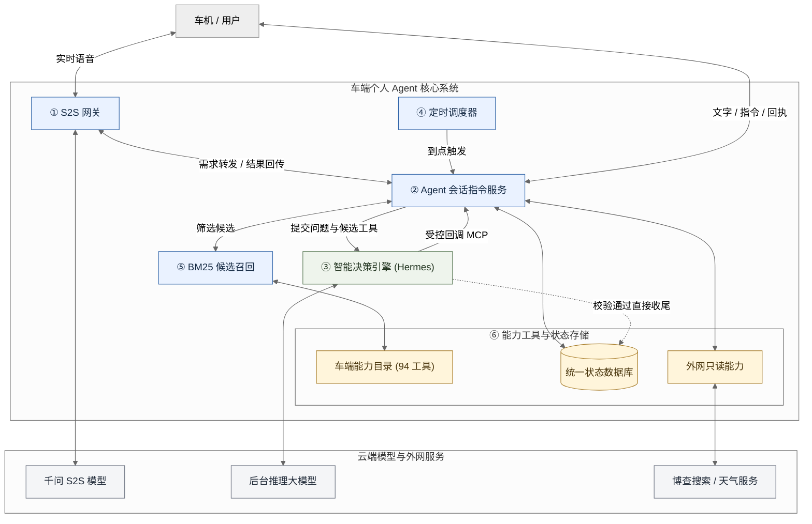
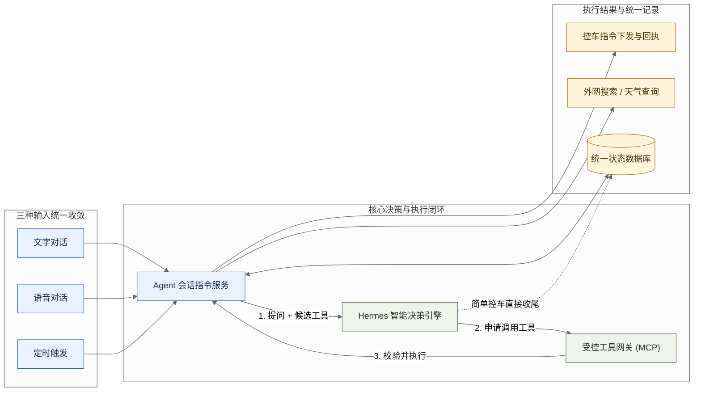
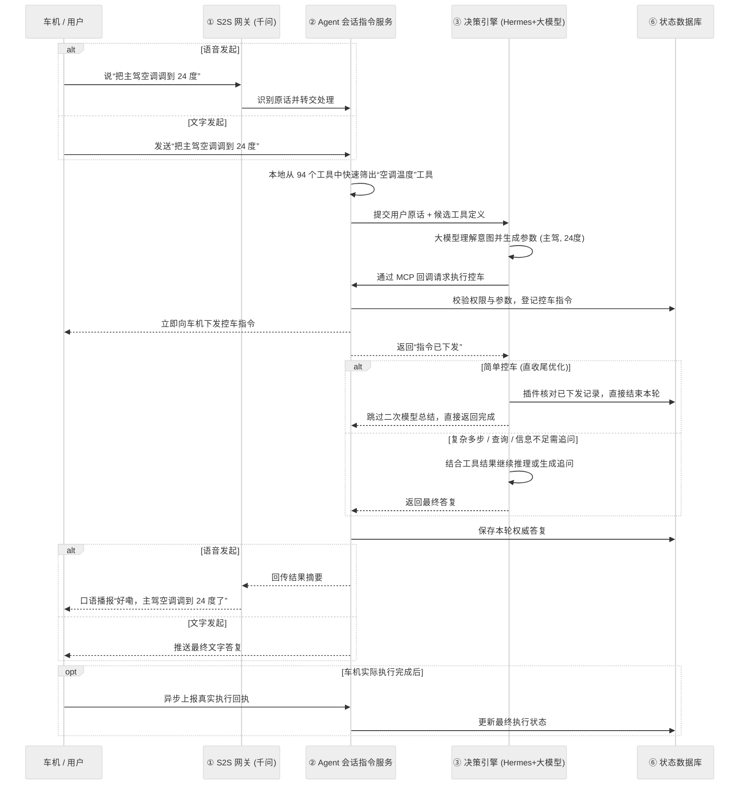
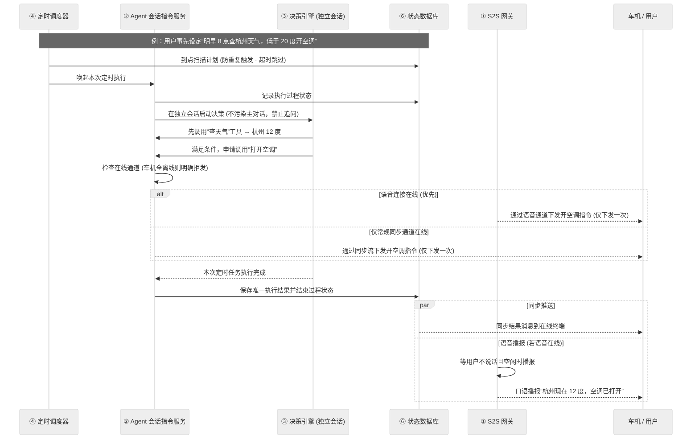

# 车端个人 Agent 技术介绍（Mermaid 内联版）

> 本文档为 `agent-overview.md` 的 Mermaid 源码内联版本，所有架构图与时序图直接使用 `mermaid` 代码块渲染，方便直接复制到飞书、语雀、Notion、GitLab / GitHub 或 Typora 中查看。当前为 **第一章：系统全景、核心模块与协作关系**。

## 第一章：系统全景与核心模块关系

### 1.1 一句话看懂这个项目

这是一个面向智能座舱的个人 Agent 后端系统：接收车机/用户的文字或实时语音指令，自动理解用户想做什么，并安全、准确地完成**车端控车与查车况（94 项车端协议能力）**、**联网搜索与查天气**，以及**一次性/周期定时任务的自动执行**。

为了让系统既响应快、对话自然，又安全可控、不乱控车，整个 Agent 采用了一个核心设计思路——把「听和说」、「管会话与指令」、「想和决策」拆开，各司其职：

- **听和说**：交给专门的实时语音模型（千问 S2S）与 S2S 网关，保证低延迟语音交互；
- **管会话、验权限、发指令**：由我们自己的「Agent 会话指令服务」牢牢把控，防止大模型越权或胡乱下发指令；
- **想和决策**：复用成熟的开源 Agent 运行时 Hermes 驱动后台推理大模型（如 DeepSeek），负责多步思考与参数生成。

**与真车的边界**：本 Agent 不直接耦合底层车控硬件，而是以**「下发标准控车指令 + 接收车机异步执行回执」**作为清晰契约，方便接入任意车机端执行器。

### 1.2 系统全景与六大核心模块

剥离底层部署细节，整个 Agent 由 **6 大核心模块**协同组成（图中仅标明模块定位与流向，具体承接功能见 1.3 节）：

| 编号 | 模块名称 | 核心定位 | 对应核心代码 / 组件 |
| --- | --- | --- | --- |
| ① | S2S 网关 | 实时语音桥接前台 | `VoiceBridge`（`app/realtime.py`） |
| ② | Agent 会话指令服务 | 会话、鉴权与控车执行中枢 | Agent 主服务（`app/main.py`、`app/client_turns.py`） |
| ③ | 智能决策引擎（Hermes） | 意图理解与多轮推理大脑 | Hermes Gateway + `hermes_plugins/` + `app/mcp_server.py` |
| ④ | 定时调度器 | 定时计划落库与到期唤起 | `ScheduledTasks`（`app/scheduled_tasks.py`） |
| ⑤ | BM25 候选召回 | 94 车端工具本地快速预筛 | `VehicleToolIndex`（`app/vehicle_tool_search.py`） |
| ⑥ | 能力工具与状态存储 | 车端协议目录、外网查询与统一事实库 | `capabilities/vehicle_protocol/`、`app/web_tools.py`、`app/store.py`、`app/shared_messages.py` |

### 1.3 各模块具体承接的功能

#### ① S2S 网关（`app/realtime.py`）

- **实时音频双向桥接**：代理车机/客户端与云端千问 Audio Realtime 的 WebSocket 连接（16 kHz 上行 / 24 kHz 下行），密钥仅留后端不暴露给客户端。
- **语音需求转发与结果回传**：日常闲聊由 S2S 直接响应；涉及控车、查车况、联网或定时需求时，通过 `route_vehicle_input` 转发给「Agent 会话指令服务」，并承接执行结果摘要转回 S2S 输出语音。
- **语音体验与稳定性治理**：通过 `NotificationGate` 控制空闲播报时机（不抢话、插话只停播不取消后台任务）；以 S2S 口语原位覆盖同轮消息避免双气泡；输出 `response_id` 响应边界防止跨轮串话，并记录断连来源与关闭码。

#### ② Agent 会话指令服务（`app/main.py`、`app/client_turns.py`）

- **统一接入与设备鉴权**：承接文字对话（POST SSE）、S2S 网关转交、定时调度器触发三路入口，校验设备配对与绑定版本，拦截越权或过期请求。
- **轮次状态机与上下文控制**：为每轮对话签发唯一轮次 ID 与一次性临时令牌（`turn_token`），维护「进行中 / 等待追问 / 完成 / 失败」状态；按预算自动轮换会话代次，并为定时任务分配独立隔离会话。
- **候选工具预加载协同**：在提交 Hermes 之前，先调用「BM25 候选召回」筛选精简候选 Schema 注入上下文，同时提供模型按需二次搜索与分域浏览能力。
- **MCP 工具审批与参数校验**：大模型发起任何控车、追问、查外网或设定时申请时，必须通过 MCP 回调本服务核验令牌、工具范围、车端 Schema 与敏感操作二次确认，不合规直接驳回。
- **控车指令下发与防重发**：将校验通过的指令下发给在线车机（支持一句话多意图批量下发与程序化逐项汇总）；定时控车实行单通道原子认领（语音通道优先、全离线拒发），避免多端重复控车。
- **回执回收与状态落库**：接收车机异步上报的真实执行回执与车况读数，将消息、执行过程与指令结果统一写入状态数据库并同步至在线终端。

#### ③ 智能决策引擎（Hermes + 插件 + MCP 桥接）

- **原生 Agent Loop 推理**：由独立运行的 Hermes Gateway 驱动后台大模型（如 DeepSeek），负责自然语言意图理解、多意图拆解、参数生成、缺参追问与多步工具编排。
- **最小权限 MCP 桥接**：通过 stdio 拉起 `app/mcp_server.py`，将全部能力收口为 8 个受控通用入口回调「Agent 会话指令服务」；显式关闭终端、文件、浏览器等无关系统工具。
- **非侵入式插件扩展**：不改 Hermes 核心源码，挂载 `bailian_limits`（统一约束输出 token 上限，兼容多模型网关）与 `vehicle_completion`（简单控车校验下发后直接读库短路收尾，省去尾轮模型总结请求）。

#### ④ 定时调度器（`app/scheduled_tasks.py`）

- **计划持久化与周期计算**：支持一次性（`once`）、每天（`daily`）、每周（`weekly`）计划的创建、查询、暂停、恢复与取消，准确维护下次触发时间。
- **高可靠到期唤起**：进程内 0.5s 轮询扫描到期计划，内置 60 秒触发宽限期（超时记 `missed` 不误补跑）、同计划防重入、设备解绑自动暂停以及服务重启时的中断对账收口。
- **隔离执行联动**：到期时调用 Agent 会话指令服务拉起隔离会话执行（硬禁止发起追问），自动推送执行过程步骤与最终结果。

#### ⑤ BM25 候选召回（`app/vehicle_tool_search.py`）

- **车端语料归一化与切词**：内置汽车领域同义词表（如风速 → 风量、抬头显示 → HUD、香薰 → 香氛）、口语停用词过滤与无外部依赖的中文 2/3-gram 切词。
- **多字段加权 BM25 预计算**：将 94 个车端协议工具拆分为标题、槽位、触发词、工具名、业务域、描述 6 个加权字段，启动时离线预计算稀疏权重表，查询阶段亚毫秒（< 1ms）完成打分。
- **多意图拆分与车端精排**：自动拆分复合长句分别召回再合并，并叠加超大枚举门控、反例边界强压制与「控制 vs 查询」意图对齐，显著提升首轮候选命中率。

#### ⑥ 能力工具与状态存储

- **车端能力目录（94 工具）**：以声明式 JSON Schema 管理 94 项真实车端控车与查车况协议（`capabilities/vehicle_protocol/`），配合 `app/vehicle_receipts.py` 规范化回执与读数；扩充工具只需更新目录配置。
- **外网只读能力（`app/web_tools.py`）**：接入博查联网搜索（结果裁剪限长、凭据脱敏、失败降级防编造）与 Open-Meteo 实时天气（城市地理编码缓存 + 瞬态建连超时重试），调用前释放数据库写锁避免阻塞。
- **统一状态数据库（`app/store.py`、`app/shared_messages.py`）**：以 SQLite（WAL 模式）作为唯一业务事实源，统一持久化设备绑定、轮次事件、车控指令与回执、共享消息流、执行过程事件及定时计划表。

### 1.4 模块之间的核心协作闭环

所有模块的协作可以概括为**「三路输入汇聚 → 思考与校验闭环 → 统一执行与落库」**：

理解这张图只需抓住 4 个关键机制：

1. **所有入口统一收口**：不管是文字提问、语音转交还是定时到点触发，全部汇入「Agent 会话指令服务」，共用同一套鉴权、工具与状态规则，不会出现文字和语音两套逻辑打架。
2. **先用 BM25 筛工具，再请大脑思考**：车端有 94 个协议工具，全部塞给大模型既慢又费 Token。Agent 会话指令服务先经「BM25 候选召回」筛出最相关的几个候选工具，再交给 Hermes 决策。
3. **大脑只提申请，服务层负责把关执行**：Hermes 里的模型不能直接控车，必须通过受控工具网关（MCP）回调 Agent 会话指令服务；核验「本轮临时令牌 + 设备授权 + 参数格式」全部通过后，才会真正向车机发出指令并跟踪执行回执。
4. **简单控车直收尾（省掉一轮模型等待）**：对于明确、单步的控车指令，指令下发并入库后，Hermes 内的轻量插件会直接核对数据库记录并结束本轮，不再多等一次大模型总结，大幅压低响应耗时。

### 1.5 用两个真实场景走通全流程

#### 场景 A：实时控车——用户说「把主驾空调调到 24 度」

#### 场景 B：定时自动执行——「明早 8 点查杭州天气，低于 20 度开空调」

## 后续章节规划

> 第一章确认后依次展开：

- **第二章**：为什么选 Hermes，以及我们是怎么深度集成与改造的（核心优势、自主学习闭环机制、MCP 权限隔离、直收尾与限流插件、上下文管理）
- **第三章**：Agent 会话指令服务与 94 个车端工具的 BM25 检索、校验与执行机制
- **第四章**：S2S 语音网关体验治理与定时任务调度设计
- **第五章**：整体运行部署方案、对外接口与当前系统边界
