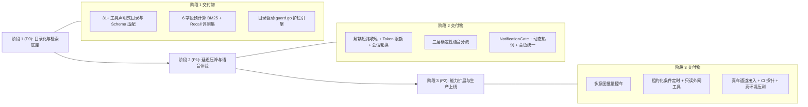

# 车端个人 Agent 架构优化路线图

> 本文档基于当前 `app_personal_agent` 基线代码（`main` / `2a3b207`）、[H07 联调与延迟基线](./h07-end-to-end.md)，并结合 [业务 MCP 工具清单](./mcp/业务%20MCP%20工具清单.md)、[MCP 工具 Schema](./mcp/MCP%20工具%20Schema.md) 以及同源 Python 架构参考（[系统架构参考](./old/personalagetn架构.md)、[BM25 检索参考](./old/BM25.md)），梳理后续工程化扩量、降延迟与生产上线的可优化项。

---

## 1. 现状基线与核心红线

### 1.1 当前基线评估

当前项目已完成 H00–H09 全链路闭环及 SQLite/MySQL 双存储支持（并完成 PR #12 的恢复路径与播放回执持久化加固），实测核心基线如下（数据来源：[H07 联调报告](./h07-end-to-end.md#延迟基线)）：

| 维度 | 当前现状 | 主要瓶颈 / 待演进点 |
| --- | --- | --- |
| **车控能力规模** | `vehicle/catalog/catalog.go` 内置 6 个硬编码 Demo 能力（车窗/空调） | 真实业务 MCP 已有 31 个工具（注册 26 个），老项目协议目录达 94 个，当前硬编码与静态规则无法直接扩量 |
| **首轮延迟（闲聊）** | 冷连接 P50 **1.475s** / P95 **1.622s**；热连接 P50 **1.420s** / P95 **1.630s** | `plainChat` 仅放行 11 个固定短语，绝大多数自由闲聊被错分到 5 秒级的车控链路 |
| **首轮延迟（车控）** | 冷连接 P50 **6.827s** / P95 **8.003s**；热连接 P50 **5.276s** / P95 **5.532s** | 单步写操作后仍等待 Hermes 跑完尾轮大模型总结，而 `vehicle/turns/service.go` 最终丢弃了该总结文本 |
| **语音与 ASR 治理** | 固定 4 词位置热词；400ms 轮询结果播报；本机 TTS 替代车端音色 | 扩量后热词覆盖不足；多源异步播报需统一调度闸门；闲聊与车控播报音色尚未统一 |
| **扩展能力** | 仅支持单轮单写车控、查车况、查手册 | 缺少多意图批量控车、条件型定时任务、只读联网/天气能力及真实车辆通道适配 |

### 1.2 优化过程中必须守住的架构红线

相比 `doc/old/` 的 Python 单体原型，当前 Go + Hermes 架构在安全边界、状态机一致性与并发可靠性上明显更严谨。**后续所有优化均不得破坏以下 5 条红线**：

1. **Go 侧唯一写入授权与护栏**：模型与客户端均不可伪造用户/会话/车辆身份；所有控车写操作必须经过可信轮次绑定（`X-Vehicle-Turn-Handle` + `params._meta`）和 Go 侧意图/参数校验。
2. **Hermes 零直连业务数据库**：Hermes 仅作为无业务持久化状态的推理与编排引擎，所有状态读写必须收敛在 Go MCP / 服务接口之内。
3. **严格两阶段确认与真回执播报**：指令入队/受理阶段只能播报「正在处理」，只有收到单调递增的车辆终态回执或新鲜车况确认后，才能生成幂等结果事件（`command_id:status`）并播报「已完成」。
4. **独立多任务待回复生命周期**：保留最多 3 条 `pending_reply` 候选、乐观锁 `version`、10 分钟精确过期、部分补参与取消围栏（`LockWritableTurn`），不退化为整轮覆盖式单状态。
5. **确定性语音路由优先于 S2S 自主判断**：存在未过期 `pending_tasks` 时，短回复必须由 Go 网关确定性路由至车控链路，杜绝双路同时出声或短回复被 S2S 误当闲聊。

---

## 2. 优化总览矩阵

| 优先级 | 编号 | 优化主题 | 主要落点模块 | 核心收益 |
| --- | --- | --- | --- | --- |
| **P0** | P0-1 | 声明式能力目录与真实业务 MCP Schema 对齐 | `vehicle/catalog/`、`vehicle/mcp/`、`vehicle/executor/` | 支撑从 6 个 Demo 能力平滑扩展到 31–94 个真实工具，零代码改目录 |
| **P0** | P0-2 | BM25 升级为 6 字段加权预计算 + 车端精排与评测集 | `vehicle/catalog/bm25.go` | 查询 < 1ms，大幅降低大工具集下的误召回与控制/查询混淆 |
| **P0** | P0-3 | 写入护栏 `guard.go` 重构为目录驱动规则引擎 | `vehicle/mcp/guard.go`、`vehicle/catalog/` | 解除仅支持 `window`/`hvac` 的硬编码限制，扩量新设备不失守 |
| **P1** | P1-1 | 解耦版单步控车「短路收尾」+ Token 限额 + 会话轮换 | `vehicle/mcp/`、`hermes/`、`vehicle/turns/` | 车控热连接 P50 预期下降 **1.5s–2.5s**，防止长会话上下文膨胀 |
| **P1** | P1-2 | 语音分流策略升级（摆脱 11 词白名单限制） | `voice/gateway/connection.go` | 自由闲聊回归 1.4s S2S 原生出声，同时保持车控零漏判 |
| **P1** | P1-3 | 统一 `NotificationGate`、动态 ASR 热词与音色统一 | `voice/gateway/`、`realtime/qwen/` | 消除异步播报抢话、降低车控专词识别错字、统一播报音色 |
| **P2** | P2-1 | 一句话多意图批量控车与程序化逐项汇总 | `vehicle/tasks/`、`vehicle/mcp/`、`vehicle/executor/` | 支持「开空调 24 度顺便关左后窗」一轮下发、逐项回执 |
| **P2** | P2-2 | 条件型定时任务调度（多实例租约安全版） | 新增 `vehicle/scheduler/`、`vehicle/turns/` | 支持「明早 8 点查天气，低于 20 度开空调」，且不引入单点风险 |
| **P2** | P2-3 | 外网只读工具（搜索/天气）与锁隔离规范 | 新增 `vehicle/web/`、`vehicle/mcp/` | 补齐座舱信息服务，杜绝慢 IO 阻塞数据库锁或模型编造 |
| **P2** | P2-4 | 生产加固：真实通道契约、CI 兼容性探针与全链路观测 | `vehicle/executor/`、`cmd/h01probe/`、CI | 消除 Hermes 升级断层，满足真车大样本压测与多端协同上线标准 |

---

## 3. P0：能力扩量与检索底座优化（接入真实工具前必做）

### P0-1：声明式能力目录与真实业务 MCP Schema 对齐

**现状痛点**
- `vehicle/catalog/catalog.go` 的 `defaultOperationSpecs()` 仅硬编码了 6 个 `window` / `hvac` Demo 操作；`FieldSpec` 仅支持 `string`、`number`、`array_string` 三种基础类型，无法表达真实业务 Schema 的复杂约束。
- 对照 [业务 MCP 工具清单](./mcp/业务%20MCP%20工具清单.md) 与 [MCP 工具 Schema](./mcp/MCP%20工具%20Schema.md)，真实车控/车况/备车 MCP 已具备 31 个工具（dev 注册 26 个），存在大量 Demo 未覆盖的协议特征：
  - **互斥参数组**：如 `ac_ctrl` 中 `temperature`（绝对设温）与 `temperature_tune`（相对调温）互斥；
  - **字符串型数值枚举与复合结构**：如档位/延时字段为字符串枚举（`"0"` / `"2"` / `"5"` / `"10"`），`vehicle_prep_ctrl` 包含嵌套动作数组与预约时间；
  - **本地辅助与后过滤**：如 `resolve_time_tool`（先解析自然语言时间再调预约工具）、`query_car_status`（本地信号聚合查询与字段裁剪）；
  - **环境与车型裁剪**：依赖 `disable_tools` 与按车型配置动态屏蔽不支持的能力；
  - **身份字段隔离**：部分上游 Schema 可能含 `vin` / `deviceKey` / `runtime` 等运行时上下文，严禁暴露给 LLM 填写。

**优化方案**
1. **目录配置外部化与版本化**：借鉴 `doc/old` 的 `capabilities/vehicle_protocol/` 模式，将 `OperationSpec` 拆为独立声明式 JSON/YAML 文件，支持 `catalog_version` 校验、按 `VehicleProfile` 动态加载数值边界与 `disable_tools` 黑白名单。
2. **扩展 `FieldSpec` 单一事实源能力**：在 `vehicle/catalog/catalog.go` 中扩展 `boolean`、`integer`、`object`/`array_object`、`oneOf` / 互斥字段组（`MutuallyExclusive`）与至少填一（`RequireAnyOf`）规则，同时服务 JSON Schema 生成与 Go 入参校验。
3. **建立 Canonical 能力到真实业务 MCP 的适配层**：
   - 对 Hermes 仍暴露收口后的受控工具集合，并在暴露前自动剥离所有敏感身份/会话字段（由 Go 侧从可信 `Scope` 注入）；
   - 将 `resolve_time_tool` 等纯计算/时间归一化能力封装为 Go 侧只读工具或确定性预处理步骤；
   - 将 `vehicle/catalog/status.go` 与 `query_car_status` / `car_airconditioner_status` / `car_charging_info` 对接，保持「新鲜度检查 + 效果确认」语义不变。

**验证标准**
- 新增一个车端工具仅需提交声明式配置与映射单测，无需修改 `vehicle/catalog` 核心代码；
- 覆盖 [MCP 工具 Schema](./mcp/MCP%20工具%20Schema.md) 中全部 26 个已注册工具的 Schema 生成、边界值校验、互斥参数拒收与敏感字段剥离单测。

---

### P0-2：BM25 检索升级为 6 字段加权预计算 + 车端精排

**现状痛点**
- `vehicle/catalog/bm25.go`（第 188–222 行）当前存在 4 个明显短板：
  1. **每次请求动态建索引**：`FindCapabilities` 每次调用都对全量 `specs` 拼接长字符串并执行 `buildBM25Index(corpus)`，扩量至 31–94 个工具后重复计算开销大；
  2. **单字段平铺无权重**：设备名、工具名、别名、例句、描述全部拼进 `specCorpusText`，长描述会稀释核心标题与槽位词的权重；
  3. **缺少车端语料归一化**：无汽车领域同义词映射（如 `风速→风量`、`抬头显示→hud`、`香薰→香氛`、`起雾→除雾`、`车门玻璃→车窗`），且未剥离位置词（`主驾/副驾/左后/二排`），导致位置词在多设备间抢占匹配分；
  4. **缺少大枚举门控与意图对齐**：接入 `deeplink_ctrl`（页面跳转）或大量座椅/车灯/应用枚举工具后，纯 BM25 极易出现误召回或「查状态 vs 控车」排序反转。

**优化方案（借鉴 [BM25.md](./old/BM25.md) 并针对性改良）**
1. **6 字段加权 BM25 + 启动时离线预计算稀疏权重表**：
   - 拆分字段并赋权：`title`（2.8）、`slot`（2.2）、`trigger`（2.1）、`name`（1.2）、`category`（1.1）、`desc`（0.75，构建索引前自动剥离反例句）；
   - 启动加载目录或热更新版本时一次性计算 `bm25Weights[term]`（参考 `k1=1.2, b=0.25`），查询期仅按车型启用的能力掩码做 O(query_terms) 查表累加，**将 94 工具召回稳定压在 < 1ms**。
2. **领域同义词归一化 + 位置词剥离 + 改进分词**：
   - 索引构建与查询共用同一套汽车同义词表与停用词表；BM25 打分前剥离位置词（位置留给参数解析与 Guard）；
   - **改良分词策略**：在无外部依赖的中文 2/3-gram 滑窗基础上，**保留车控核心单字动词/状态白名单**（如 `开/关/升/降/冷/热/锁/停/亮/暗`），规避老项目纯 2/3-gram 对「关窗」「太冷」等极短口语词召回受损的问题。
3. **车端精排修正（带数据门禁）**：
   - 精确命中核心标题/工具名/枚举标签加权；
   - **大枚举工具门控（`gated_weights`）**：对 `deeplink_ctrl` 等高基数枚举工具要求命中语境词（如「页面/应用/跳转」）才释放枚举加分；
   - **反例短语压制**：命中工具声明的「非本工具/不负责」边界词时显著降权；
   - **控制 vs 查询意图对齐**：识别用户问句/状态查询特征 vs 动作控制特征，对齐对应 `MCPTool`（`get_vehicle_status` vs `dispatch_vehicle_command`）。
4. **多意图子句切分（仅限召回阶段）**：
   - 按标点及「同时 / 顺便 / 另外 / 再把」拆分子句分别召回，再按去重并集合并候选工具列表；
   - **严格约束**：子句切分仅用于扩大候选工具召回覆盖面，送给 Hermes 与 `guard.go` 的仍然是**完整原始转写句**，避免「先别开空调，帮我把左后窗关了」在切句后丢失否定/条件语义。
5. **建设离线评测集取代经验调参**：
   - 在引入各类加权与乘法系数前，先建立覆盖 31–94 工具的固定评测语料（含口语同义、短追问、多意图、否定句、易混查询句），以 **Recall@4 / Recall@6、MRR、控制/查询混淆率、大枚举误召回率** 作为 PR 回归门禁。

---

### P0-3：写入护栏 `guard.go` 重构为目录驱动规则引擎

**现状痛点**
- `vehicle/mcp/guard.go`（第 225–373 行）中的 `candidateMatchesUtterance` 与 `verifyUtteranceAlignment` 当前采用 `switch device { case "window": ... case "hvac": ... default: return false }` 硬编码。
- **直接风险**：一旦接入第 3 类设备（如座椅加热 `seat_heat_ctrl`、后备箱 `trunk_ctrl`、充电控制 `charge_start_stop_ctrl`），待办候选续办匹配将直接返回 `false`，且新设备缺失原话-参数对齐防幻觉校验。

**优化方案**
1. **将护栏元数据下沉至声明式能力目录**：为每个 `OperationSpec` 声明：
   - 动作词典（正向动词/互斥反向动词，如开 vs 关、解锁 vs 闭锁、启动 vs 停止）；
   - 槽位提取器声明（枚举同义词表、数值单位正则如 `度/档/%/分钟`、相对调节点词如 `调高/降低/升高一档`）；
   - 敏感操作等级（如 `car_lock_ctrl` 解锁、`front_trunk_ctrl`/`trunk_ctrl` 车外开启、`charge_start_stop_ctrl` 等是否要求显式确认）。
2. **通用化 `evaluateWriteIntent`**：
   - 通用只读问句/否定取消拦截仍作用于整句（并区分「不要开空调，把窗关上」这类局部否定句，减少误杀）；
   - 候选消歧与短回复补参校验改为遍历 `c.MissingFields`，直接用对应字段的声明式槽位提取器判断原话是否覆盖了缺失槽位；
   - 原话-参数对齐改为逐字段比对「模型提交参数 vs 原话提取值 / 历史 `KnownParams`」，防止模型凭空编造槽位值。

**验证标准**
- 接入新设备时无需修改 `guard.go` 主流程代码；
- 保留原有全部边界用例（查询隔离、否定隔离、短回复缺 `task_id` 拒降级、双候选消歧、幻觉参数拦截）100% 通过，并扩展覆盖座椅/门锁/充电/相对调温场景。

---

## 4. P1：端到端延迟压降与语音体验治理

### P1-1：解耦版单步控车「短路收尾」+ Token 限额 + 会话轮换

**现状痛点**
- [H07 延迟基线](./h07-end-to-end.md#延迟基线) 显示，车控热连接从说完到首帧音频的 P50 为 **5.276s**（P95 **5.532s**），冷连接高达 **6.827s**（P95 **8.003s**），远高于闲聊的 **1.42s**。
- 查看 `vehicle/turns/service.go`（第 220–248 行）可以发现：当本轮发生 `create_vehicle_task`（`pending_reply`）或 `dispatch_vehicle_command`（`pending_dispatch` / `executing`）写入后，Go 侧 `Service.reply()` **直接依据 `ProgressReader` 生成确定性播报文本**（追问文案或「正在处理车辆指令。」），**完全忽略了 Hermes 跑完工具调用后二次调用大模型生成的 `run.Output`**！这意味尾轮大模型总结 RTT（通常 1.5s–2.5s）属于 100% 无效等待。
- 同时，`vehicle/turns/service.go:169` 将 Hermes 会话 ID 固定为 `"vehicle-" + scopeKey(turn.Scope)`，长期对话缺乏上下文预算管理与会话代次轮换，会导致历史上下文越积越长、首轮推理越来越慢。

**优化方案**
1. **解耦版「单步写入短路收尾」**（借鉴 `doc/old` 的 `vehicle_completion` 思路，但**严格不让 Hermes 读数据库**）：
   - 当 `vehicle/mcp/server.go` 成功完成单步写操作（`create_vehicle_task` 进入追问，或 `dispatch_vehicle_command` 已入 Outbox 且本轮非多意图复合指令）时，在 MCP 工具响应的 `_meta`（或约定结构化字段）返回 `"vehicle.short_circuit": true`；
   - 在 Hermes 侧通过轻量插件/适配器识别该标记后直接以确定性终态结束本次 Run，**彻底省去尾轮大模型总结请求**；
   - Go 侧继续由 `ProgressReader` 输出两阶段播报（「要关哪扇车窗？」或「正在处理车辆指令。」），**绝不提前播报「已完成」**。
2. **输出 Token 上限约束（借鉴 `bailian_limits` 插件）**：
   - 在 Hermes 侧为语音车控场景统一设置合理的 `max_tokens` 上限（例如查询/手册问答限短口语答复），防止后台推理模型输出长篇大论拖慢 TTS 与推理耗时。
3. **Hermes 会话代次自动轮换**：
   - 参考 `doc/old` 的预算轮换机制，当同一 `vehicle-<scope>` 会话的累计轮次或 token 超过阈值且当前无活跃 `pending_reply` 任务时，自动递增会话代次（如 `vehicle-<scope>-g2`），保持每轮推理上下文轻量化。
4. **连接预热与耗时分段埋点**：
   - 保持车端与 Qwen Realtime 的长连接健康保活与平滑重连，避免冷连接握手（实测 1.13s–1.97s）落入用户按键说话路径；
   - 细化 `transcript.final` → `bm25.recall` → `hermes.admit` → `mcp.tool_call` → `hermes.done` → `tts.first_frame` 全链路分段耗时指标，定位每一百毫秒去向。

**预期收益**
- 车控热连接首帧播报 P50 从 **5.28s** 压降至 **~2.5s–3.5s**（直接削减 1 次完整 LLM 总结 RTT）；长会话下 P95 延迟保持稳定不劣化。

---

### P1-2：语音分流策略升级（摆脱 11 词白名单限制）

**现状痛点**
- `voice/gateway/connection.go`（第 251–271 行）中的 `plainChat()` 当前仅硬编码了 11 个精确匹配短语（`你好/嗨/哈喽/早上好/下午好/晚上好/谢谢/你是谁/讲个笑话/给我讲个笑话/讲个故事`）。
- 一旦用户说「今天心情不错」「帮我推荐一部电影」「杭州有什么好玩的」等正常闲聊，全部都会落入 `vehicle = true`，经 Hermes + Go MCP 绕一大圈，既拉高 3–4 倍延迟，也增加了后台推理模型成本。

**优化方案**
保持「Go 网关确定性主裁、安全优先（宁可误进车控，不可漏进闲聊）」原则，升级为**三层轻量分流**：

1. **第一层（硬规则，0ms）**：若当前 `scope` 存在未过期的 `pending_tasks`（`len(pending) > 0`），除极少数明确无歧义全局中断词外，**一律走车控链路**，防止短回复（「左后窗」「24 度」「开吧」）被误分流到 S2S 闲聊。
2. **第二层（本地车端召回与特征信号，< 1ms）**：复用 P0-2 的内存预计算 BM25 与车端触发词/查询词/定时词/外网工具词匹配：
   - 命中车控/车况/手册/定时/外网特征（得分高于阈值）→ 确定性进入 Hermes 车控链路；
   - 命中纯寒暄/明确闲聊白名单 → 直接走 Qwen S2S 原生出声（~1.4s）。
3. **第三层（低延迟意图拒识 / 兜底）**：对前两层均未命中的灰色句（如开放闲聊、常识问答、隐喻表达如「车里有点闷」），可接入极轻量本地分类器或小模型 fast-router（预算 < 150ms），并支持配置「隐喻表达词表」（`太冷/太热/好闷/晒死/看不清` → 走车控），超时或不确定时默认降级至车控链路确保安全。

**验证标准**
- 构建包含 200+ 条真实座舱语料（直白车控、隐喻车控、待办短回复、车况查询、手册问答、开放闲聊）的分流评测集：
  - 车控/待办短回复漏判率 **0%**；
  - 自由闲聊直通 S2S 命中率 **≥ 90%**。

---

### P1-3：统一 `NotificationGate`、动态 ASR 热词与音色统一

**现状痛点**
- **播报调度**：`voice/gateway/connection.go`（第 84、101–104 行）目前通过 400ms `Ticker` 轮询 `refreshResults(true)`；未来引入多意图回执、定时任务播报、异常提醒后，缺乏统一优先级队列与事件驱动唤醒。
- **静态热词**：`realtime/qwen/qwen.go`（第 214–216 行）仅硬编码 4 个位置热词（`左前窗/右前窗/左后窗/右后窗`）。H07 实测已证明无热词时「左后窗」易误识为「做后窗」；扩量至 31–94 工具后，大量座舱专词（如 `香氛/除雾/后视镜/前备箱/侧滑门/遮阳帘/胎压/哨兵模式`）均存在同样风险。
- **音色割裂**：当前闲聊走 Qwen S2S 原生音色（`longanqian_v3.1`），而车控追问与执行结果走独立外部/本机 TTS，车内听感割裂。PR #12 已新增 `realtime/qwen/read_aloud.go` 验证了 Qwen 指定文本复述探针，但尚未工程化接入生产播报路径。

**优化方案**
1. **引入统一 `NotificationGate` 与事件驱动推送**：
   - 用内部事件通道（结合低频兜底对账）替代纯 400ms 轮询，降低回执到播报的额外抖动；
   - 统一排队管理「车辆执行结果」「定时任务播报」「系统异常通知」，严格仅在 `recording == nil && current == nil && playing == nil` 时出队播报；
   - 坚持「用户插话打断仅停播当前音频、绝不取消已提交车控指令」，并在客户端协议层支持同轮口语原位更新以避免 ASR/播报双气泡。
2. **动态 ASR 热词治理**：
   - 将 `realtime/qwen/qwen.go` 中的静态热词改为由 `VehicleProfile` + 启用能力目录生成的核心热词集（按车型裁剪，优先覆盖高频易错位置词、设备专词与档位词），控制词表规模与权重防止过度偏置；
   - 持续保留 Go 侧对原始 `FinalTranscript` 的校验，不把识别纠偏风险转嫁给无约束 LLM。
3. **播报音色统一评估与安全封装**：
   - 方案 A（优先推荐）：对接百炼同音色流式 TTS（与 Qwen Realtime `longanqian_v3.1` 音色对齐），确定性复述、零改写风险、首包延迟可控；
   - 方案 B（复用 Qwen Read-Aloud）：若采用 `realtime/qwen/read_aloud.go` 复用复述会话，必须复用连接池消除建连开销，并强制启用 `response.audio_transcript.done` 与 Go 权威文本一致性校验，发现偏移立即告警/降级至确定性 TTS。

---

## 5. P2：能力扩展与生产化加固

### P2-1：一句话多意图批量控车与程序化逐项汇总

**现状痛点**
- 当前 `vehicle_turn_writes` 以 `(scope_key, request_id)` 唯一键强约束「一轮最多一次写入」，无法一次处理「把主驾空调调到 24 度，顺便关一下左后窗」或「打开座椅加热和方向盘加热」这类座舱高频复合指令。

**优化方案**
- **演进写幂等粒度**：支持批量下发工具（如 `dispatch_vehicle_batch`）或将写入键扩展为 `(scope_key, request_id, seq)`，在同一数据库事务内原子校验并登记多条子任务/命令 Outbox（全部校验通过才提交，或清晰区分可立即执行项与需追问项）。
- **程序化汇总播报与分项回执**：每条子指令保持独立 `command_id` 与独立车辆回执确认；首轮处理中播报与终态汇总播报均由 Go 侧按实际子任务状态程序化拼装，防止模型漏报或混报某一项结果。

---

### P2-2：条件型定时任务调度（多实例安全演进版）

**现状痛点**
- 当前仅支持即时车控与业务 MCP 中的静态车端预约（如 `timed_charge_ctrl`、`vehicle_prep_ctrl`），尚不支持跨能力联动的条件型定时计划（例如「明早 8 点查杭州天气，低于 20 度自动打开空调」）。

**优化方案（借鉴 `doc/old` 的 `app/scheduled_tasks.py` 并升级为多实例架构）**
1. **完整继承经过验证的业务语义**：
   - 支持 `once` / `daily` / `weekly` 的创建、查询、暂停、恢复、取消；
   - **60 秒触发宽限期**：超窗标记 `missed` 绝不误补跑过期车控指令；
   - **隔离会话 + 硬禁追问**：到期触发使用独立 `scheduled-<plan_id>-<run_id>` 会话，不污染主对话，且在 MCP/Guard 层硬禁止生成 `pending_reply`；
   - **单通道原子认领 + 全离线拒发**：语音通道优先，全离线明确记录失败不盲发；
   - **车辆解绑自动暂停 + 重启对账收口**。
2. **用租约调度替代单进程 0.5s 轮询**：
   - 沿用 H03/H05 已验证的 `lease_owner` + `lease_until` + MySQL `FOR UPDATE SKIP LOCKED` / SQLite `BEGIN IMMEDIATE` 机制，确保多副本部署下同一计划实例绝不重复触发。

---

### P2-3：外网只读工具（搜索/天气）与锁隔离规范

**现状痛点**
- 定时条件触发与日常座舱问答常依赖实时天气、路况或联网搜索，当前 Go MCP 尚无对应外网只读能力。

**优化方案（借鉴 `doc/old` 的 `app/web_tools.py` 工程实践）**
- **严禁持锁调用外部 HTTP**：所有外网工具调用（天气、联网搜索、高德 POI）必须在数据库事务/作用域写锁之外执行，杜绝外部慢请求阻塞同车控车轮次或引发 SQLite `SQLITE_BUSY`。
- **防编造与安全治理**：强制响应长度裁剪（防止大网页撑爆上下文）、凭据与内网地址脱敏、明确返回结构化失败提示（禁止模型静默编造天气/新闻）、对城市地理编码做本地缓存并对瞬态建连超时做有限退避重试。

---

### P2-4：生产环境加固、真实通道接入与升级守门

**现状痛点**
- [H07 联调报告](./h07-end-to-end.md#故障与边界覆盖) 明确指出，真实车辆通道、车机麦克风/扬声器、百炼业务空间专属域名及真实样本规模下的 P50/P95 仍有待真环境验证。
- `hermes/turn_binding_adapter.py` 通过运行时 Hook 适配了 Hermes `vgit.72c88037` 的若干内部函数（`_handle_runs`、`_execute_run`、`_run_agent_sync`、`_admission_scope`、`_call_tool_racing_stdio_death` 等），未来升级 Hermes 存在签名漂移风险。
- 文字端与语音端尚未共享统一的持久化时间线与播放状态回传视图。

**优化方案**
1. **真实车辆通道契约落地**：基于 `vehicle/executor/channel.go` 制定真实车控网关接入规范（下游幂等键映射、异步回执签名/乱序/重复处理、未知状态 `result_unknown` 主动对账超时窗口与车况新鲜度 SLA）。
2. **Hermes 升级兼容性 CI 守门 + 上游推动**：
   - 将 `cmd/h01probe` 与 `hermes/test_turn_binding_adapter.py` 纳入每次 Hermes 版本升级的必跑 CI 检查；
   - 长期向 Hermes 上游推动原生的「按 Run 透传 MCP `params._meta` 与自定义 HTTP Header」扩展点，逐步替换内部私有函数 Hook。
3. **真环境压测与全链路可观测性**：
   - 在百炼业务空间专属域名（`wss://{WorkspaceId}.{Region}.maas.aliyuncs.com`）与真实录音样本上补齐 ≥ 50 样本/组的 P50/P95/P99 分阶段延迟基线；
   - 统一以 `voice_turn_id` / `request_id` / `run_id` / `task_id` / `command_id` 串联结构化日志与 Prometheus/OTel 指标，对 `result_unknown`、护栏拒收、BM25 零召回、TTS 失败率、ASR 重连率建立告警。
4. **多端（语音 + 文字 + 定时）共享事件流**：
   - 在 `voice_turns` / `vehicle_tasks` / `vehicle_result_events` 之上提供统一的只读聚合时间线视图（借鉴 `doc/old` 的 `shared_messages` 思路），让 App 文字界面与车机语音共享一致的状态卡片与执行步骤。

---

## 6. 借鉴老项目时必须规避的反模式

在吸收 [doc/old](./old/personalagetn架构.md) 中优秀工程实践的同时，以下 6 类做法**不得原样搬入**当前项目：

| 老项目做法 | 潜在风险 | 本项目改良策略 |
| --- | --- | --- |
| Hermes `vehicle_completion` 插件直接读状态库 | 破坏跨进程与数据库边界，导致 Schema 耦合与多语言维护成本 | Go MCP 在工具响应 `_meta` 返回短路标记，Hermes 仅认协议标记、零接触 DB |
| 指令下发后即由 S2S 口语播报「已调到 24 度了」 | 车机离线/拒执行/执行失败时产生虚假成功播报（严重座舱安全/体验事故） | 坚持两阶段播报：受理说「正在处理」，真回执或新鲜车况确认后才说「已完成」 |
| 由 S2S 模型通过 `route_vehicle_input` 自主决定是否转交车控 | 易出现短回复（「左后窗」）被 S2S 直接闲聊吞掉或双路抢话 | 坚持 Go 网关先检 `pending_tasks` 与本地信号做确定性分流，不把主裁权交回 S2S |
| BM25 仅使用纯 2/3-gram 切词 | 「关窗」「升窗」「太冷」等极短指令容易丢失关键单字动词/状态 | 2/3-gram 滑窗 + 车控核心单字动词/状态白名单，配合固定评测集验证 |
| 复合句切分子句后直接独立路由/执行 | 丢失跨子句否定或条件前缀（如「别开空调，只把车窗关了」） | 切子句仅用于扩大 BM25 候选工具并集；送 Hermes 与 `guard.go` 始终保留完整原句 |
| 定时调度器依赖单进程 0.5s 内存轮询 | 多副本部署会产生重复触发与脑裂下发 | 升级为数据库租约认领（`FOR UPDATE SKIP LOCKED` / SQLite `BEGIN IMMEDIATE`） |

---

## 7. 分阶段实施路线图与验收指标

### 阶段验收指标建议

| 阶段 | 关键验收指标 | 目标值 |
| --- | --- | --- |
| **阶段 1（P0）** | 31+ 工具 BM25 查询耗时（P99） | **< 1 ms** |
| **阶段 1（P0）** | 固定车控评测集候选召回率（Recall@6） | **≥ 97%** |
| **阶段 1（P0）** | 只读查询 / 否定取消 / 幻觉参数误写入率 | **0%** |
| **阶段 2（P1）** | 车控热连接首帧播报延迟（P50 / P95） | **≤ 3.0s / ≤ 4.0s**（基线 5.28s / 5.53s） |
| **阶段 2（P1）** | 自由闲聊直通 S2S 命中率 / 车控漏判率 | **≥ 90% / 0%** |
| **阶段 2（P1）** | 车控高发专词 ASR 首次识别准确率 | **≥ 95%** |
| **阶段 3（P2）** | 多副本定时调度重复触发率 & 超窗误补跑率 | **0%** |
| **阶段 3（P2）** | 真车通道崩溃恢复 / 重复回执 / 重复播报率 | **0%**（沿用 H05/H07 强一致语义） |
